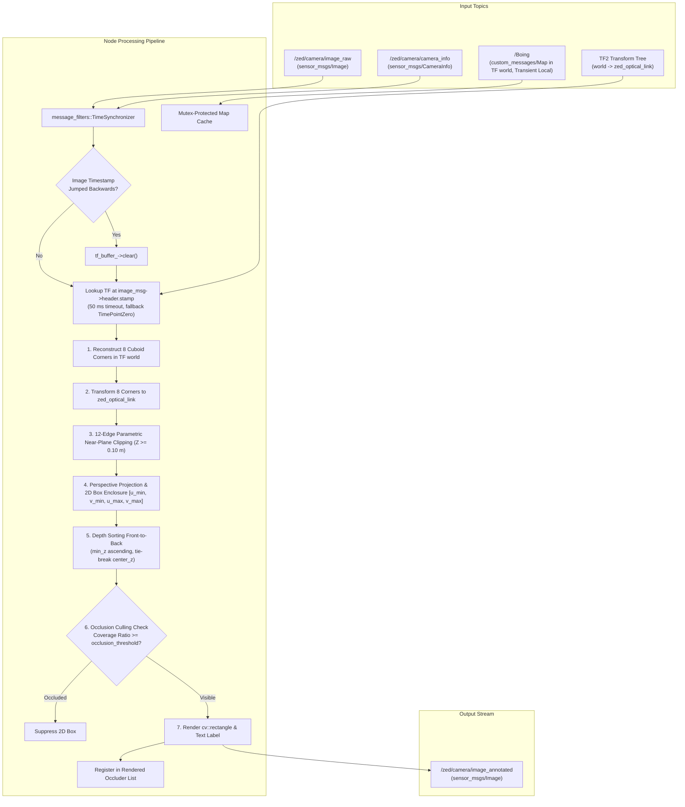
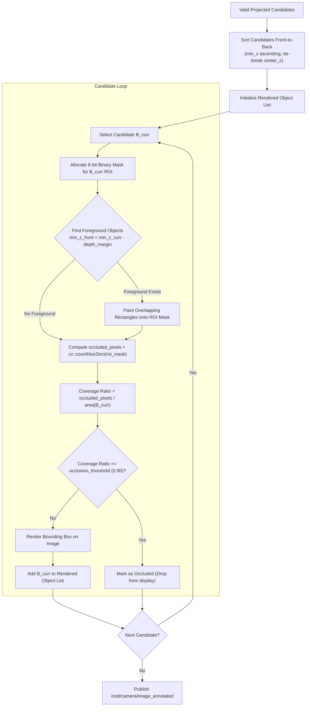

# Bounding Box Image Overlay Node
## Ground-Truth 2D Vision Projection, Near-Plane Edge Clipping, and Occlusion Culling

**Package:** `cr5_gazebo`  
**Source Code:** [`bbox_image_overlay_node.cpp`](../src/bbox_image_overlay_node.cpp)  
**Author:** Robotics Engineering Team  
**Date:** November 2026  

---

## Table of Contents

1. [Overview](#overview)
2. [Architectural Role & Dataflow](#architectural-role--dataflow)
3. [ROS 2 Architecture, QoS & Temporal Synchronization](#ros-2-architecture-qos--temporal-synchronization)
4. [Pinhole Camera Geometry & Perspective Projection](#pinhole-camera-geometry--perspective-projection)
5. [3D Cuboid Reconstruction & Timestamped TF Lookup](#3d-cuboid-reconstruction--timestamped-tf-lookup)
6. [Near-Plane Edge Clipping Algorithm](#near-plane-edge-clipping-algorithm)
7. [Coverage Ratio (IoB) Occlusion Culling](#coverage-ratio-iob-occlusion-culling)
8. [OpenCV Rendering Pipeline](#opencv-rendering-pipeline)
9. [ROS 2 Configurable Parameters](#ros-2-configurable-parameters)
10. [Computational Performance](#computational-performance)
11. [Diagnostics & Visual Verification](#diagnostics--visual-verification)

---

## Overview

The `BboxImageOverlayNode` is a high-performance vision processing component that **visually verifies the geometric accuracy and optical alignment of the Gazebo 3D ground-truth oracle** by reprojecting 3D bounding boxes directly onto the robot's 2D camera feed.

The node performs:
1. **Multi-Modal Data Synchronization:** Pairs camera images and calibration metadata via `TimeSynchronizer`, caches latched `/Boing` maps via Transient Local QoS, and queries TF transforms at the exact image capture timestamp.
2. **3D-to-2D Perspective Projection:** Reconstructs 3D bounding cuboids from the TF `"world"` frame and projects them onto the image sensor plane using pinhole optics.
3. **Near-Plane Edge Clipping:** Solves perspective division singularities ($Z \to 0$) when the robot arm inspects plants from close proximity ($20\text{ cm}$).
4. **Cumulative Coverage Ratio (IoB) Occlusion Culling:** Sorts objects front-to-back (`min_z` with `center_z` tie-breaking) and suppresses bounding boxes hidden behind closer objects using an efficient binary ROI mask.

The resulting annotated stream on `/zed/camera/image_annotated` serves a dual purpose: it directly validates that Gazebo AABBs, $SE(3)$ robot-frame alignment, TF transforms, and visibility rules match what the camera actually observes, and it provides YOLO-style 2D ground-truth annotations suitable for inspecting and building **training, validation, and testing datasets** for machine learning perception models.

---

## Architectural Role & Dataflow



---

## ROS 2 Architecture, QoS & Temporal Synchronization

### 1. Synchronized Image and Camera Info Streams
Camera image buffers (`sensor_msgs/msg/Image`) and optical calibration metadata (`sensor_msgs/msg/CameraInfo`) share identical hardware capture timestamps. The node pairs them using a `message_filters::TimeSynchronizer`:

```cpp
image_sub_.subscribe(this, "/zed/camera/image_raw");
cam_info_sub_.subscribe(this, "/zed/camera/camera_info");

sync_ = std::make_shared<message_filters::TimeSynchronizer<sensor_msgs::msg::Image, sensor_msgs::msg::CameraInfo>>(
  image_sub_, cam_info_sub_, 10);
sync_->registerCallback(std::bind(&BboxImageOverlayNode::syncCallback, this, 
  std::placeholders::_1, std::placeholders::_2));
```

### 2. Transient Local Map Subscription & Thread-Safe Caching
Because `OracleFrustumCulling` publishes `/Boing` with **Transient Local** durability (latching) at 10 Hz, `BboxImageOverlayNode` configures its `/Boing` subscriber with a matching `KeepLast(1)` and `transient_local()` QoS profile:

```cpp
rclcpp::QoS map_qos(rclcpp::KeepLast(1));
map_qos.transient_local();
map_sub_ = this->create_subscription<custom_messages::msg::Map>(
  "/Boing", map_qos,
  std::bind(&BboxImageOverlayNode::mapCallback, this, std::placeholders::_1)
);
```

This guarantees that even if `BboxImageOverlayNode` initializes after the Oracle has latched an updated map, it immediately receives the latest `/Boing` state. Incoming messages are stored under a `std::mutex`:

```cpp
void mapCallback(const custom_messages::msg::Map::SharedPtr msg)
{
  std::lock_guard<std::mutex> lock(map_mutex_);
  latest_map_ = msg;
}
```

### 3. Simulation Time Reset Handling
The node tracks `last_image_stamp_` (initialized to `rclcpp::Time(0, 0, RCL_ROS_TIME)`). If Gazebo simulation time is reset and the incoming image timestamp jumps backwards (`current_stamp < last_image_stamp_`), the node flushes `tf_buffer_` immediately so stale pre-reset transforms are never reused:

```cpp
rclcpp::Time current_stamp(image_msg->header.stamp);
if (last_image_stamp_.nanoseconds() > 0 && current_stamp < last_image_stamp_) {
  tf_buffer_->clear();
}
last_image_stamp_ = current_stamp;
```

---

## Pinhole Camera Geometry & Perspective Projection

The optical system is modeled using the classical **Pinhole Camera Model**.

```
           Y_cam
             ^       Z_cam (Optical Axis)
             |      /
             |     /
             |    /
             |   +-------------------+  (Image Plane at focal distance f)
             |  /|                   |
             | / |       (u, v)      |
             |/  |         *         |
 Camera (0,0,0)  +---------|---------+
                 \         |        /
                  \        |       /
                   \       |      /
                    \      |     /
                     v     v    v
                    +X_cam
```

### Intrinsic Calibration Matrix

The camera intrinsics are extracted from the $3 \times 3$ intrinsic matrix $K \in \mathbb{R}^{3 \times 3}$ provided in `sensor_msgs/msg/CameraInfo`:

$$K = \begin{bmatrix} f_x & 0 & c_x \\ 0 & f_y & c_y \\ 0 & 0 & 1 \end{bmatrix}$$

- $f_x, f_y$: Focal lengths expressed in pixel units along the horizontal and vertical axes.
- $c_x, c_y$: Principal point coordinates (optical center) in pixel space.

### Projection Equations

Given a point $\mathbf{p}_{cam} = (X, Y, Z)^T$ expressed in the camera optical frame (`zed_optical_link`), its projection $(u, v)$ onto the 2D image plane is:

$$u = \frac{X}{Z} f_x + c_x, \quad v = \frac{Y}{Z} f_y + c_y$$

---

## 3D Cuboid Reconstruction & Timestamped TF Lookup

Each object received from `/Boing` is specified by its antipodal extents `low_left` ($P_{\min}$) and `top_right` ($P_{\max}$).

> [!NOTE]
> **Coordinate Frame Consistency:** Bounding boxes on `/Boing` are expressed in the **TF `"world"` frame** (the URDF root / robot model frame matching the Oracle's default `global_frame`), **not** Gazebo's scene-origin `gazebo_world` frame.

### Vertex Expansion

The node reconstructs the 8 canonical vertices of the cuboid in TF `"world"`:

$$\begin{aligned}
V_0 &= (x_{\min}, y_{\min}, z_{\min})^T, \quad &V_1 &= (x_{\max}, y_{\min}, z_{\min})^T \\
V_2 &= (x_{\min}, y_{\max}, z_{\min})^T, \quad &V_3 &= (x_{\max}, y_{\max}, z_{\min})^T \\
V_4 &= (x_{\min}, y_{\min}, z_{\max})^T, \quad &V_5 &= (x_{\max}, y_{\min}, z_{\max})^T \\
V_6 &= (x_{\min}, y_{\max}, z_{\max})^T, \quad &V_7 &= (x_{\max}, y_{\max}, z_{\max})^T
\end{aligned}$$

### Timestamp-Synchronized TF Lookup with Fallback

During robot arm motion, querying `tf2::TimePointZero` (the latest available transform) introduces synchronization skew between the image capture instant and the end-effector pose, causing projected 2D bounding boxes to visibly lag or drift relative to the video stream.

First, the node normalizes `camera_frame` (falling back from empty or `"zed_camera"` to `"zed_optical_link"`). It then queries the transform at the exact capture timestamp `image_msg->header.stamp` with a 50 ms timeout, falling back to `tf2::TimePointZero` if the exact timestamp cannot be interpolated:

```cpp
std::string camera_frame = cam_info_msg->header.frame_id;
if (camera_frame.empty() || camera_frame == "zed_camera") {
  camera_frame = "zed_optical_link";
}

geometry_msgs::msg::TransformStamped t;
try {
  t = tf_buffer_->lookupTransform(
    camera_frame, "world",
    rclcpp::Time(image_msg->header.stamp),
    rclcpp::Duration::from_seconds(0.05));
} catch (const tf2::TransformException &) {
  try {
    t = tf_buffer_->lookupTransform(camera_frame, "world", tf2::TimePointZero);
  } catch (const tf2::TransformException & ex) {
    RCLCPP_WARN_THROTTLE(this->get_logger(), *this->get_clock(), 2000,
      "TF Error: %s", ex.what());
    return;
  }
}
```

Using this transform, all 8 vertices are mapped into `zed_optical_link`:

$$\mathbf{p}_{cam, i} = \mathbf{T}_{cam \leftarrow world}(t_{\text{img}}) \begin{bmatrix} V_i \\ 1 \end{bmatrix}, \quad \forall i \in \{0, \dots, 7\}$$

### Cuboid Edge Topology

The cuboid volume is bounded by 12 spatial edges connecting the vertices:

$$\mathcal{E} = \left\{
(0,1), (1,3), (3,2), (2,0), \;
(4,5), (5,7), (7,6), (6,4), \;
(0,4), (1,5), (2,6), (3,7)
\right\}$$

---

## Near-Plane Edge Clipping Algorithm

### The Close-Range Perspective Singularity

When the Dobot CR5 approaches a plant during close-range scanning (e.g., at $20\text{ cm}$ distance), portions of the plant's 3D bounding box can reach depths near zero ($Z \to 0$) or even pass behind the optical center ($Z \le 0$).

Because perspective projection divides by $Z$:

$$\lim_{Z \to 0^+} \left( \frac{X}{Z} f_x + c_x \right) = \pm \infty$$

Without clipping:
1. Projected coordinates explode to tens of thousands of pixels.
2. Clamping functions clamp coordinates to $[0, W-1]$ and $[0, H-1]$.
3. The resulting 2D bounding box expands to cover the entire screen ($640 \times 480$), corrupting visual monitoring.

### Parametric 12-Edge Clipping Solution

The node clips all 12 edges against the near clipping plane $Z = Z_{near} = 0.10\text{ m}$ (matching the physical near-clipping limit of the ZED camera sensor).

```
               Edge Clipping Geometry
               
      P1 (Z < Z_near)                   P2 (Z >= Z_near)
        [Behind Lens]                    [In Front of Lens]
              *--------------------------------*
                               ^
                               |
                     +---------|---------+  Near Plane (Z = Z_near)
                     |       P_clip      |
                     |                   |
```

For each edge $e = (P_1, P_2) \in \mathcal{E}$:

1. **Both Endpoints in Front ($P_{1.z} \ge Z_{near} \land P_{2.z} \ge Z_{near}$):**
   Both points are valid. Project both directly into pixel coordinates.

2. **Both Endpoints Behind ($P_{1.z} < Z_{near} \land P_{2.z} < Z_{near}$):**
   The entire edge is outside the visible frustum. Discard edge.

3. **Edge Crosses Near Plane ($P_{1.z} < Z_{near} \le P_{2.z}$ or vice-versa):**
   Compute the exact intersection point $P_{clip}$ along the line segment using parametric linear interpolation:
   $$t = \frac{Z_{near} - P_{1.z}}{P_{2.z} - P_{1.z}} \in [0, 1]$$
   $$P_{clip} = P_1 + t (P_2 - P_1) = \begin{bmatrix} P_{1.x} + t(P_{2.x} - P_{1.x}) \\ P_{1.y} + t(P_{2.y} - P_{1.y}) \\ Z_{near} \end{bmatrix}$$
   Project $P_{clip}$ (evaluated at $Z = Z_{near}$) and the endpoint lying in front of the plane.

### 2D Enclosing Rectangle Calculation

From the set of all projected points $\mathcal{P}_{2D} = \{(u_k, v_k)\}$, the tight 2D bounding box is computed:

$$u_{\min} = \min_k u_k, \quad u_{\max} = \max_k u_k, \quad v_{\min} = \min_k v_k, \quad v_{\max} = \max_k v_k$$

clamped to the image resolution $[0, W - 1] \times [0, H - 1]$.

---

## Coverage Ratio (IoB) Occlusion Culling

### Problem Definition: Geometric Overlap vs Occlusion

In multi-object scenes, an object located behind another object can be partially or completely hidden from the camera's point of view. Drawing full bounding boxes for completely hidden objects clutters the visual display.

Traditional Intersection over Union (IoU) fails when evaluating occlusion between objects of different sizes (e.g., a small plant completely hidden behind a large bin produces low IoU, despite being 100% occluded).

The node adopts the **Coverage Ratio** (also known as **Intersection over Background - IoB**):

$$\text{Coverage Ratio}(B) = \frac{\text{Area}(\text{Intersection of } B \text{ with Foreground})}{\text{Area}(B)}$$

### Two-Phase Occlusion Pipeline



### Depth Ordering (Front-to-Back with `center_z` Tie-Breaker)

For each projected cuboid candidate, the node computes both the closest-corner depth and the mean corner depth along the camera optical axis:

$$Z_{\min} = \min_{i \in \{0..7\}} P_{cam, i.z}, \qquad Z_{\text{center}} = \frac{1}{8} \sum_{i=0}^{7} P_{cam, i.z}$$

Candidates are sorted front-to-back in ascending order of $Z_{\min}$, breaking near-ties ($|Z_{\min, a} - Z_{\min, b}| \le 10^{-3}\text{ m}$) deterministically using $Z_{\text{center}}$:

```cpp
// Sort candidates front-to-back (lowest min_z first, tie-break with center_z)
std::sort(candidates.begin(), candidates.end(), [](const ProjectedCandidate& a, const ProjectedCandidate& b) {
  if (std::abs(a.min_z - b.min_z) > 1e-3) {
    return a.min_z < b.min_z;
  }
  return a.center_z < b.center_z;
});
```

### Cumulative Multi-Object Occlusion Mask

If two foreground objects $A_1$ and $A_2$ each cover 50% of background object $B$ (e.g., left and right halves):
- A pairwise check would evaluate each at 50% and fail to suppress $B$ if the threshold is 90%.
- By allocating an 8-bit single-channel ROI mask (`cv::Mat roi_mask`) corresponding to $B$'s rectangle, the node paints all overlapping regions from closer objects into the mask:

```cpp
cv::Mat roi_mask = cv::Mat::zeros(safe_cand_rect.size(), CV_8UC1);
for (const auto& front_obj : rendered) {
  if (front_obj.min_z < cand.min_z - depth_margin) {
    cv::Rect inter = safe_cand_rect & front_obj.rect;
    if (inter.width > 0 && inter.height > 0) {
      cv::Rect local_inter(inter.x - safe_cand_rect.x, inter.y - safe_cand_rect.y, 
                           inter.width, inter.height);
      roi_mask(local_inter).setTo(255);
    }
  }
}
```

The true occluded area is counted via hardware-accelerated population count (`cv::countNonZero`):

$$\text{Coverage Ratio} = \frac{\text{countNonZero}(\text{roi\_mask})}{\text{Area}(\text{safe\_cand\_rect})}$$

If $\text{Coverage Ratio} \ge \text{occlusion\_threshold}$ (default: $0.90$), the object is culled.

### Depth Margin Guard ($\text{depth\_margin} = 0.05\text{ m}$)

To prevent objects resting on the same surface or adjacent to one another from occluding each other due to minor bounding box contact, an object is only treated as an occluder if it is strictly closer along the optical axis by at least $\text{depth\_margin}$:

$$Z_{front} < Z_{cand} - \text{depth\_margin}$$

---

## OpenCV Rendering Pipeline

For all visible candidates surviving the occlusion check:

1. **Color Coding:**
   - **Target Objects (Plants):** Drawn in green `cv::Scalar(0, 255, 0)` with thickness 2.
   - **Obstacles (Laptops, Bins, Tables):** Drawn in red `cv::Scalar(0, 0, 255)` with thickness 2.
2. **Annotation Label:**
   - A text label (`"Target"` or `"Obstacle"`) is rendered at the top-left corner of the box using `cv::putText` (with `text_y = std::max(12, safe_cand_rect.y - 5)`).
3. **Image Serialization:**
   - The annotated OpenCV matrix `cv_ptr->image` is converted back to `sensor_msgs/msg/Image` via `cv_bridge::toImageMsg()` and published on `/zed/camera/image_annotated`.

---

## ROS 2 Configurable Parameters

| Parameter Name | Data Type | Default Value | Description |
|---|---|---|---|
| `enable_occlusion_culling` | `bool` | `true` | Enables/disables occlusion culling |
| `occlusion_threshold` | `double` | `0.90` | Fractional coverage threshold for suppression ($0.90 = 90\%$) |
| `depth_margin` | `double` | `0.05` | Minimum depth difference in meters to consider an object an occluder |

Parameters can be adjusted at runtime:

```bash
ros2 param set /bbox_image_overlay_node occlusion_threshold 0.85
ros2 param set /bbox_image_overlay_node enable_occlusion_culling false
```

---

## Computational Performance

- **Near-Plane Edge Clipping:** Operates on fixed 12 edges per candidate. Computational cost is $\mathcal{O}(N)$ where $N$ is the number of visible objects in the frustum (typically $N < 20$).
- **Occlusion Mask Evaluation:** Evaluated on small 2D sub-rectangles (typically $100 \times 100$ pixels). The execution overhead measured using `std::chrono` is under **$0.02\text{ ms}$** per frame, sustaining the **15 Hz** simulated ZED camera framerate with ample headroom well beyond 30+ FPS.

---

## Diagnostics & Visual Verification

### Visual Verification via RQT

To observe the real-time annotated camera output:

```bash
ros2 run rqt_image_view rqt_image_view /zed/camera/image_annotated
```

### Visual Verification in RViz2

1. In RViz2, add an **Image** display.
2. Set the topic to `/zed/camera/image_annotated`.
3. Verify that:
   - Target plants display crisp green bounding boxes.
   - Obstacles display red bounding boxes.
   - Approaching an object does not cause bounding box explosion.
   - Rapid arm motion exhibits zero projection lag thanks to timestamped TF lookup.
   - Occluded objects behind obstacles cleanly disappear when covered by more than 90%.
