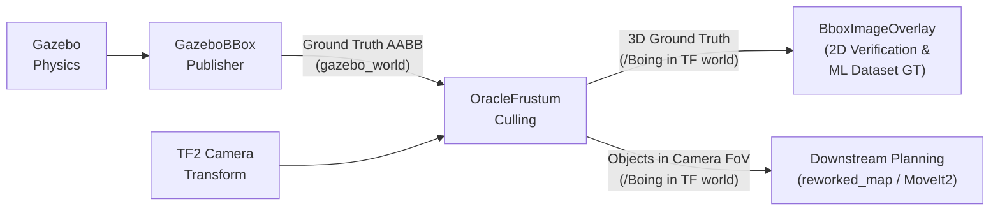
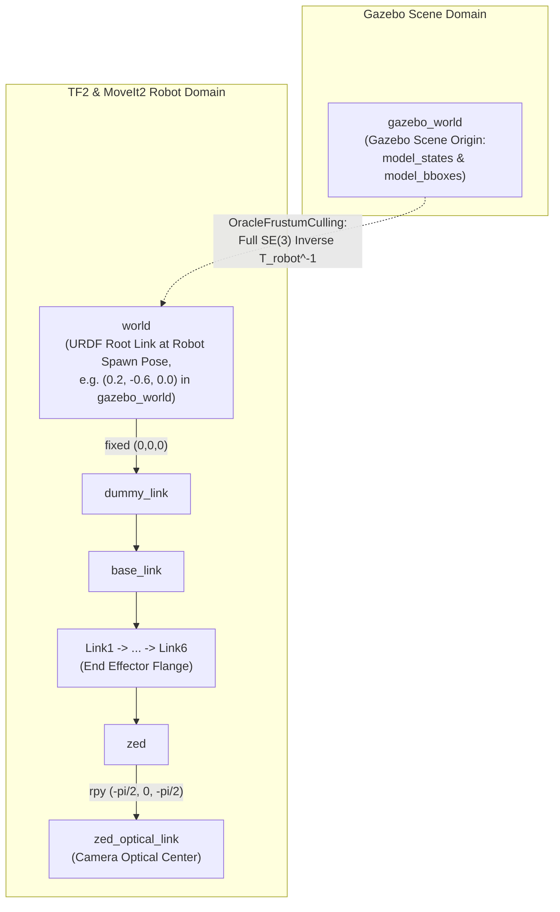
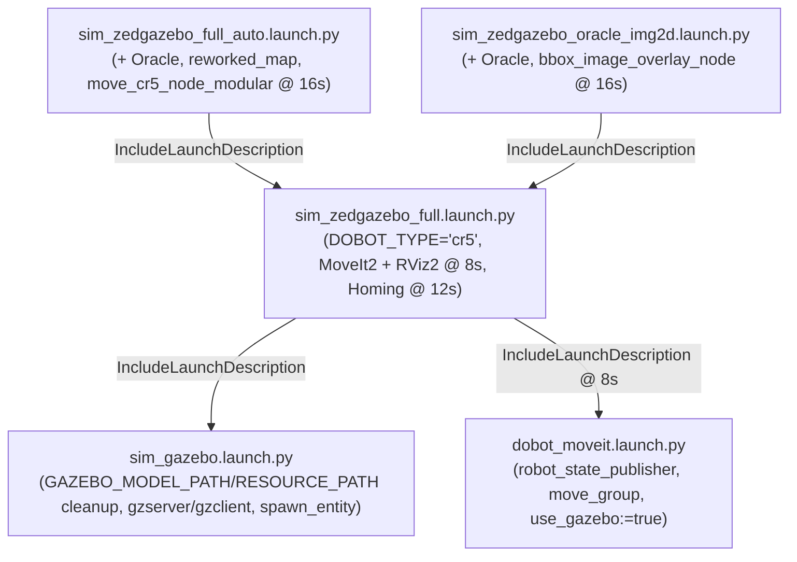
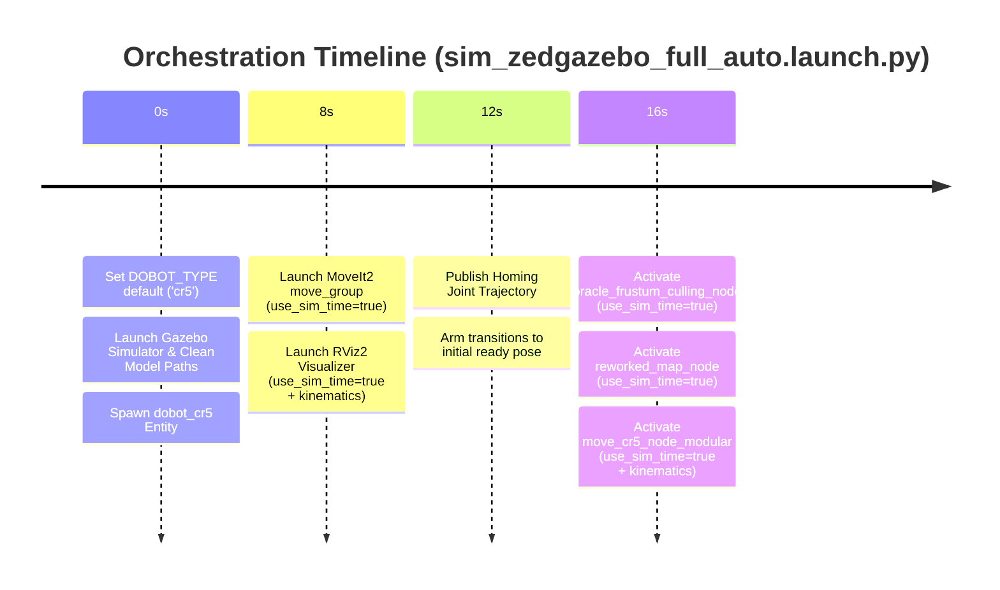
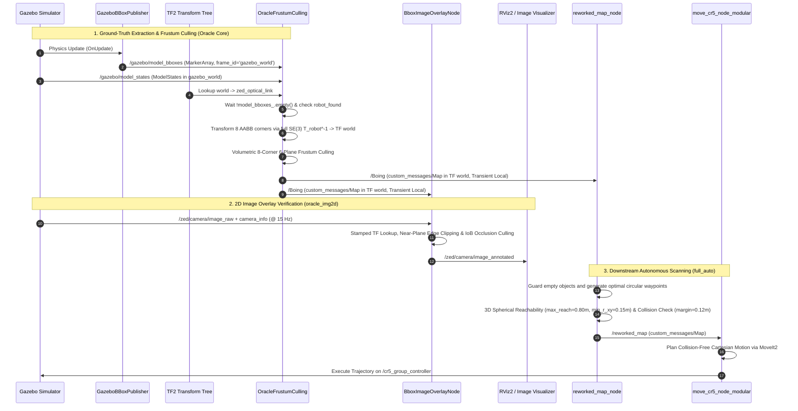

# CR5 Gazebo Simulation & Perception Framework
## Master System Documentation & Architectural Specification

**Package:** `cr5_gazebo`  
**Version:** 0.1.0  
**Author:** Robotics Engineering Team  
**Date:** November 2026  
**ROS 2 Distribution:** Humble Hawksbill  

---

## Table of Contents

1. [Executive Summary & Framework Overview](#executive-summary--framework-overview)
2. [Package Architecture & Directory Structure](#package-architecture--directory-structure)
3. [The Oracle Sensor Paradigm](#the-oracle-sensor-paradigm)
4. [Simulation Worlds & Accurate Collision Mechanics](#simulation-worlds--accurate-collision-mechanics)
5. [Coordinate Frames & Optical Alignment](#coordinate-frames--optical-alignment)
6. [Launch Orchestration & Staged Execution](#launch-orchestration--staged-execution)
7. [End-to-End System Pipeline & Execution Flow](#end-to-end-system-pipeline--execution-flow)
8. [Component Documentation Index](#component-documentation-index)
9. [Master Parameter Reference](#master-parameter-reference)
10. [Operating & Diagnostic Guide](#operating--diagnostic-guide)

---

## Executive Summary & Framework Overview

The `cr5_gazebo` package provides the simulation environment, world and mesh-accurate collision assets, and **ground-truth virtual perception oracle** for the Dobot CR5 robotic manipulator within the ROS 2 (Humble) and Gazebo Classic ecosystem.

The primary objective of the package is to provide an **exact, deterministic 3D geometric ground truth (Oracle) of the Gazebo simulation world**—aligned with the robot's TF frame and constrained to the on-board camera's true optical view frustum—whose geometric fidelity and optical alignment are **directly verified through 2D perspective projection (image overlay)** onto the simulated ZED camera feed.

This verified ground truth directly supports two core downstream goals:
1. **ML Dataset Generation (Training, Validation & Testing):** Producing geometrically exact, optically verified 3D/2D ground-truth annotations paired with simulated RGB-D camera streams to build structured **training, validation, and testing** datasets for training and evaluating machine learning perception models.
2. **Decoupled Trajectory Planning & Evaluation:** Enabling downstream planning stacks (such as `reworked_map_node` and MoveIt2 in `cr5_moveit_cpp_demo`) to develop, test, and evaluate autonomous scanning trajectories without the computational bottleneck, sensor noise, or segmentation errors of real-time point cloud processing.

### Framework Highlights

- **Ground-Truth Oracle Sensor (`GazeboBBoxPublisher` & `OracleFrustumCulling`):** Queries exact 3D bounding boxes directly from Gazebo's physics engine, transforms them via full $SE(3)$ alignment into the robot-centered TF `"world"` frame, and constrains them mathematically to the camera's true optical view frustum via an 8-corner volumetric test.
- **2D Overlay Ground-Truth Verification (`BboxImageOverlayNode`):** Reprojects the oracle's 3D bounding boxes (`/Boing`) back onto the simulated ZED camera stream (`/zed/camera/image_raw`), directly validating AABB tightness, TF/optical calibration, and visibility in 2D image space.
- **Close-Range & Occlusion Fidelity:** Combines **Near-Plane Edge Clipping** (preventing perspective division explosions down to $20\text{ cm}$) with **Coverage Ratio (IoB) Occlusion Culling** (filtering visually hidden boxes using cumulative multi-object coverage and deterministic depth tie-breaking).
- **Accurate Collision Worlds:** Solves Gazebo's diagonal bounding box inflation anomaly through 1:1 mesh-based collision modeling in [`first_ac.world`](../worlds/first_ac.world), guaranteeing tight, physically faithful ground-truth envelopes.
- **Staged Launch Orchestration:** Deterministic startup sequence coordinating Gazebo physics settling, `DOBOT_TYPE` environment defaults, MoveIt2 controller registration, and `use_sim_time` synchronization across both standalone oracle + 2D overlay verification (`sim_zedgazebo_oracle_img2d.launch.py`) and full closed-loop autonomous scanning (`sim_zedgazebo_full_auto.launch.py`).

---

## Package Architecture & Directory Structure

```bash
cr5_gazebo/
|-- CMakeLists.txt          # Build rules for plugins, components, and executables
|-- package.xml             # Package metadata and dependencies
|-- config/                 # Controller configuration files
|   \-- controllers.yaml    # ROS 2 control definitions
|-- launch/                 # Staged orchestration launch files
|   |-- sim_gazebo.launch.py
|   |-- sim_zedgazebo_oracle_img2d.launch.py
|   |-- sim_zedgazebo_full.launch.py
|   \-- sim_zedgazebo_full_auto.launch.py
|-- models/                 # Custom Gazebo SDF models and collision meshes
|   |-- plant/              # Single mesh plant model
|   |-- plant_1_wpot_ac/    # Accurate mesh collision potted plant variant 1
|   |-- plant_2_wpot_ac/    # Accurate mesh collision potted plant variant 2
|   |-- plant_3_wpot_ac/    # Accurate mesh collision potted plant variant 3
|   |-- pot_flower/         # Flower pot base and soil visual meshes
|   |-- labtop_mac_1/       # MacBook table obstacle
|   |-- lamp_table_small/   # Table lamp obstacle
|   \-- recycle_bin_red/    # Recycling bin obstacle
|-- rviz/                   # Visualization configurations
|   |-- zed_perception.rviz # Perception and camera overlay layout
|   \-- moveit_zed.rviz     # Full MoveIt planning scene layout
|-- src/                    # C++ source implementations
|   |-- gazebo_bbox_publisher.cpp   # Gazebo WorldPlugin (AABB extraction)
|   |-- oracle_frustum_culling.cpp  # ROS 2 Component (Frustum Culling)
|   \-- bbox_image_overlay_node.cpp # ROS 2 Component (2D Image Overlay)
|-- scripts/                # Python utility nodes
|   \-- zed_perception.py   # PointCloud2 spatial transformation prototype
|-- worlds/                 # Gazebo SDF world descriptions
|   |-- first.world         # Standard simulation world (primitive collisions)
|   \-- first_ac.world      # Accurate collision simulation world (mesh collisions)
\-- docs/                   # Formal technical documentation suite
    |-- cr5_gazebo_doc.md              # Master package documentation (this file)
    |-- gazebo_bbox_publisher_doc.md   # Plugin technical documentation
    |-- oracle_frustum_culling_doc.md  # Oracle component technical documentation
    |-- bbox_image_overlay_doc.md      # Vision overlay technical documentation
    \-- zed_perception_doc.md          # Perception prototype documentation
```

*(Note: The empty `urdf/` folder in the source tree is excluded from `CMakeLists.txt` installation rules; the robot URDF/xacro description is supplied at runtime by `dobot_rviz` and `cr5_moveit`.)*

### Key Dependencies

The package interfaces with core robotics frameworks:
- **`gazebo_ros` & `gazebo_dev`:** Direct physics integration and plugin API.
- **`rclcpp` & `rclcpp_components`:** High-performance composable ROS 2 node architecture.
- **`tf2_ros` & `tf2_geometry_msgs`:** Coordinate transformations between world and sensor optical frames.
- **`custom_messages`:** Custom communication interfaces (`Map`, `Object`, `BoundingBox`).
- **`sensor_msgs`:** Sensor data interfaces (`Image`, `CameraInfo`, `PointCloud2`, and fallback `JointState` recovery publishing in `gazebo_bbox_publisher`).
- **`cv_bridge` & `OpenCV`:** High-speed computer vision rendering and ROS image conversion.
- **`message_filters`:** Exact temporal synchronization between camera streams and optical metadata.
- **Runtime Ecosystem Dependencies (`exec_depend`):** `robot_state_publisher`, `xacro`, `rclpy`, `sensor_msgs_py`, `python3-numpy`, `python3-scipy`, `rviz2`, `dobot_moveit`, and `dobot_rviz`.

---

## The Oracle Sensor Paradigm

In physical robotic systems, perceiving target plants and obstacles requires capturing dense depth maps from RGB-D cameras (such as the Stereolabs ZED), computing point clouds, segmenting geometric surfaces, and classifying clusters.

In a simulation environment, running this entire sensory chain continuously (at the simulated ZED 15 Hz rate or physical 15–30 FPS rates) alongside Gazebo physics and MoveIt2 planning consumes substantial CPU and GPU resources. Furthermore, sensor noise and segmentation errors obscure whether planning failures stem from motion planning limitations or perception failures. Establishing a visually verified 3D ground-truth oracle solves this by providing an unambiguous geometric truth of the Gazebo world—validated pixel-by-pixel against the simulated camera feed—that supports generating **training, validation, and testing** datasets for machine learning models while also isolating downstream planning evaluation from perception errors.

**Traditional Sensor Simulation (High Overhead):**


**The Oracle Sensor Approach (Zero Overhead):**



### Core Oracle Principles

1. **Absolute Ground Truth:** Bounding boxes are read directly from Gazebo's physics representation via [`GazeboBBoxPublisher`](gazebo_bbox_publisher_doc.md).
2. **Realistic Perceptual Constraints:** The [`OracleFrustumCulling`](oracle_frustum_culling_doc.md) node converts Gazebo bounds into the robot-centered TF `"world"` frame and applies exact volumetric 8-corner view frustum filtering, ensuring that downstream consumers (visual verifiers, mapping nodes, and motion planners) only receive objects physically intersecting the camera's field of view.
3. **2D Optical Ground-Truth Verification:** The [`BboxImageOverlayNode`](bbox_image_overlay_doc.md) reprojects the Oracle's 3D bounding boxes from `/Boing` back onto the simulated 2D camera feed (`/zed/camera/image_raw`), directly verifying the correctness of Gazebo AABBs, $SE(3)$ robot-spawn alignment, TF calibration, and optical visibility without adding computational overhead to downstream planners, while providing reliable 2D/3D annotations for building **training, validation, and testing** machine learning datasets.

---

## Simulation Worlds & Accurate Collision Mechanics

The package provides two primary simulation worlds: [`first.world`](../worlds/first.world) and [`first_ac.world`](../worlds/first_ac.world).

```
+--------------------------------------------------------------------------+
|                       first.world vs first_ac.world                      |
+------------------------------------+-------------------------------------+
| first.world (Primitive Collisions) | first_ac.world (Mesh-Accurate)      |
+------------------------------------+-------------------------------------+
| Uses cylinder collision primitives | Uses 1:1 trimesh collision models   |
| Causes diagonal AABB expansion     | Exact, tight bounding envelopes     |
| Inflated GT & spurious collisions  | Faithful GT & close-range scanning  |
+------------------------------------+-------------------------------------+
```

### The Cylinder Collision Anomaly in Gazebo

In `first.world`, plant models were approximated using primitive collision cylinders:

```xml
<collision name='collision'>
  <geometry>
    <cylinder>
      <radius>0.125</radius>
      <length>0.5</length>
    </cylinder>
  </geometry>
</collision>
```

When Gazebo computes the world AABB for an object with tilted or rotated collision primitives (or non-zero link orientation), the axis-aligned bounding box must enclose all rotated extremities. For cylinders with non-zero roll or pitch orientation, the resulting world AABB expanded diagonally by up to **$40\%$**, degrading the geometric fidelity of the ground truth (immediately visible as oversized projections in the 2D image overlay) and creating an artificial invisible barrier around plants that caused MoveIt2 motion planners to reject valid camera scanning trajectories.

### The Mesh-Accurate Solution (`first_ac.world`)

`first_ac.world` solves this by introducing mesh-accurate collision models:
- **`pianta_00`, `pianta_02`, `pianta_04`, `pianta_10`, `pianta_11`, `pianta_12`:** Collision geometry is replaced with `model://plant/meshes/plant.obj`.
- **`plant_1_wpot_ac`, `plant_2_wpot_ac`, `plant_3_wpot_ac`:** Custom models where the pot base, pot soil, and individual leaf clusters each have exact mesh collision geometries (`pot_base.dae`, `pot_soil.dae`, `leaf.dae`, `leaf2.dae`, `plant.dae`).

### Physics Solver Overhead Analysis

A common concern with triangle-mesh collisions is computational cost. However, in `first_ac.world`, all plants and obstacles are designated as static entities:

```xml
<static>1</static>
```

In the Open Dynamics Engine (ODE), static bodies are excluded from dynamic contact solver matrices between static entities. The physics engine computes bounding volume trees for static meshes once at startup. As a result, switching to 1:1 mesh collisions produces **zero detectable runtime performance penalty** while providing millimeter-accurate bounding boxes.

---

## Coordinate Frames & Optical Alignment

Two distinct global reference frames exist across the simulation and planning stacks, and maintaining strict separation between them is essential for spatial consistency:



1. **`gazebo_world` (Gazebo Scene Origin):** Used by Gazebo physics, `/gazebo/model_states`, and `/gazebo/model_bboxes` (default `<frame_id>` in `GazeboBBoxPublisher`, preventing RViz2 from drawing raw Gazebo markers shifted by the robot spawn offset).
2. **`world` (TF/MoveIt URDF Root):** Coincides with the Gazebo frame of the spawned `dobot_cr5` robot model (`world` $\xrightarrow{\text{fixed }(0,0,0)}$ `dummy_link` $\to$ `base_link`). `OracleFrustumCulling` converts Gazebo-world AABBs into TF `"world"` by applying the full $SE(3)$ inverse pose $\mathbf{T}_{robot}^{-1}$ across all 8 AABB corners. Downstream consumers (`reworked_map_node`, `BboxImageOverlayNode`, `zed_perception.py`) operate entirely in TF `"world"`.

### Optical Coordinate Convention

The camera optical center uses the `zed_optical_link` frame (`rpy="-1.5708 0 -1.5708"` relative to `zed`):
- **$+Z_{optical}$:** Optical axis pointing forward away from the camera lens.
- **$+X_{optical}$:** Horizontal axis pointing to the right across the image sensor.
- **$+Y_{optical}$:** Vertical axis pointing downwards towards the ground.

### Resolution of the 180° Camera Inversion Bug

During early integration, camera feeds appeared upside-down during autonomous scanning. The issue was traced to a legacy transformation in `PlantScanner::createPosePointingToCenter`:

```cpp
// Legacy code (now removed):
tf2::Quaternion z_rotation;
z_rotation.setRPY(0, 0, M_PI); // 180 deg around Z
q = q * z_rotation;
```

This legacy rotation was originally introduced to compensate for an inverted physical camera bracket. Once the URDF mount was corrected to align `zed_optical_link` directly with `Link6` ($+Z$ forward, $+Y$ down), the extra 180° rotation actively flipped the image upside-down. Removing this redundant rotation restored upright imaging across all trajectory scanning poses.

---

## Launch Orchestration & Staged Execution

Launching a complete robotic simulation (Gazebo, robot description, controllers, MoveIt2, perception nodes, and motion planners) simultaneously causes race conditions where nodes attempt to communicate before services are available.

### Composite Launch Hierarchy

To eliminate code duplication, the launch files follow a modular inclusion hierarchy:



The launch architecture uses staged initialization via `launch.actions.TimerAction`:



### Launch Files Summary

| Launch File | Command | Description |
|---|---|---|
| **[`sim_gazebo.launch.py`](../launch/sim_gazebo.launch.py)** | `ros2 launch cr5_gazebo sim_gazebo.launch.py [world:=...]` | Internal base launch file included by `sim_zedgazebo_full.launch.py`; cleans `GAZEBO_MODEL_PATH`/`GAZEBO_RESOURCE_PATH`, launches Gazebo, and spawns the robot (`spawn_entity.py` waits for `/robot_description` published by `dobot_moveit.launch.py`). Defaults to `first.world`. |
| **[`sim_zedgazebo_full.launch.py`](../launch/sim_zedgazebo_full.launch.py)** | `ros2 launch cr5_gazebo sim_zedgazebo_full.launch.py [world:=...]` | Base simulation pipeline (sets `DOBOT_TYPE='cr5'` fallback, launches Gazebo, MoveIt2, RViz2 with kinematics, and homing trajectory) without autonomous scanning nodes. |
| **[`sim_zedgazebo_oracle_img2d.launch.py`](../launch/sim_zedgazebo_oracle_img2d.launch.py)** | `ros2 launch cr5_gazebo sim_zedgazebo_oracle_img2d.launch.py world:=first_ac.world` | Perception testing pipeline; includes `sim_zedgazebo_full.launch.py` and starts `oracle_frustum_culling_node` and `bbox_image_overlay_node` at $16\text{ s}$ with `use_sim_time: True`. |
| **[`sim_zedgazebo_full_auto.launch.py`](../launch/sim_zedgazebo_full_auto.launch.py)** | `ros2 launch cr5_gazebo sim_zedgazebo_full_auto.launch.py world:=first_ac.world` | Full closed-loop autonomous system; includes `sim_zedgazebo_full.launch.py` and launches `oracle_frustum_culling_node`, `reworked_map_node`, and `move_cr5_node_modular` at $16\text{ s}$ with `use_sim_time: True`. |

> [!NOTE]
> **Environment Defaults & Simulation Time Synchronization**:
> - **`DOBOT_TYPE` Default Fallback**: `sim_zedgazebo_full.launch.py` executes `SetEnvironmentVariable(name='DOBOT_TYPE', value=os.environ.get('DOBOT_TYPE', 'cr5'))` as its first action, preventing `dobot_moveit.launch.py` from failing with a `None_moveit` lookup error when `DOBOT_TYPE` is not exported in the shell.
> - **Explicit `use_sim_time: True`**: All perception, visualization, and planning nodes (`oracle_frustum_culling_node`, `bbox_image_overlay_node`, `reworked_map_node`, `move_cr5_node_modular`, and `rviz2_gazebo`) explicitly receive `parameters=[{'use_sim_time': True}]` so all node clocks, throttles, and TF lookups synchronize cleanly with Gazebo `/clock`.
>
> **Gazebo Controller Manager Integration (`use_gazebo` argument)**:
> In `cr5_moveit/launch/demo.launch.py`, the `use_gazebo` argument (default: `true`) prevents running the standalone `controller_manager/ros2_control_node` when launching alongside Gazebo (`gzserver`), which already loads the `gazebo_ros2_control/GazeboSystem` hardware plugin via `libgazebo_ros2_control.so`. To run `demo.launch.py` standalone with the fake controller manager outside Gazebo, pass `use_gazebo:=false`.
>
> **MoveIt Kinematics & Joint Limits Configuration**:
> - **Kinematics Resolution**: `sim_zedgazebo_full.launch.py` and `sim_zedgazebo_full_auto.launch.py` load `moveit_config.robot_description_kinematics` (from `MoveItConfigsBuilder("cr5_robot", package_name="cr5_moveit").to_moveit_configs()`) directly into the RViz2 and `move_cr5_node_modular` node parameter lists. This eliminates the `No kinematics plugins defined. Fill and load kinematics.yaml!` errors and ensures MoveGroup / MoveItCpp clients instantiate valid kinematics solvers (e.g. `kdl_kinematics_plugin/KDLKinematicsPlugin`).
> - **Joint Velocity & Acceleration Limits**: In `cr5_moveit/config/joint_limits.yaml`, all arm joints (`joint1` to `joint6`) are configured with positive `max_velocity: 3.14` rad/s and `max_acceleration: 1.57` rad/s² with `has_velocity_limits: true` and `has_acceleration_limits: true`. This prevents trajectory parameterization failures (`The max_velocity is 0`) and eliminates planner warnings during autonomous trajectory generation.
>
> **Gazebo Model Path Cleanup (`Missing model.config` Elimination)**:
> In `sim_gazebo.launch.py`, `GAZEBO_MODEL_PATH` and `GazeboRosPaths.get_paths()` are filtered and intercepted to eliminate the ~532 `[Err] [InsertModelWidget.cc:403] Missing model.config` errors caused by ROS packages exporting `${prefix}/..` (such as `turtlebot3_manipulation_gazebo`, resolving to `/opt/ros/humble/share`). An isolated model directory `gazebo_models/dobot_rviz` (equipped with a minimal `model.config`) is supplied in `GAZEBO_MODEL_PATH`, and `GAZEBO_RESOURCE_PATH` is configured with `install/dobot_rviz/share` to ensure both `model://dobot_rviz/...` and `package://dobot_rviz/...` URIs resolve cleanly without exposing colcon install markers (`ament_index`, `colcon-core`) to Gazebo's model scanner.
>
> **Controller Parameters & Semantic Robot Description (SRDF) Hygiene**:
> - **Trajectory Controller Deprecation**: `cr5_group_controller` in [`controllers.yaml`](../config/controllers.yaml) and `ros2_controllers.yaml` explicitly configures `allow_nonzero_velocity_at_trajectory_end: false`, silencing the `joint_trajectory_controller` deprecation warning.
> - **Semantic Virtual Joint & ZED Camera Collision Exemptions**: `cr5_robot.srdf` defines `<virtual_joint name="fixed_base" type="fixed" parent_frame="world" child_link="dummy_link"/>` specifying the fixed transform between the world planning frame and the manipulator base link, and includes `<disable_collisions>` exemptions between the mounted `zed` camera link and `Link5`/`Link6` so MoveIt2 does not reject trajectories due to adjacent wrist/camera geometry.
> - **Process-Wide Remap Hygiene**: `move_cr5_node_modular.cpp` natively names its ROS 2 node `"move_cr5_node_modular"`. `sim_zedgazebo_full_auto.launch.py` omits process-wide `name=` CLI overrides, preventing publisher registration collisions on `/rosout` with internal helper nodes (e.g. `PlanningSceneInterface`).

---

## End-to-End System Pipeline & Execution Flow



---

## Component Documentation Index

Each node in the `cr5_gazebo` package is fully documented in its dedicated technical document:

1. **[`GazeboBBoxPublisher`](gazebo_bbox_publisher_doc.md)**
   - Gazebo Classic `WorldPlugin` querying internal physics bounding trees in `gazebo_world`.
   - Mathematical formulation of Axis-Aligned Bounding Boxes (AABB) in $\mathbb{R}^3$.
   - Full 3-axis numerical sanity filtering against corrupted or uninitialized meshes (`std::isfinite`, $|x|, |y|, |z| \le 1000\text{ m}$, and $b_{\min} \le b_{\max}$).
   - 10 Hz rate limiting and RViz2 `MarkerArray` serialization (default `frame_id = "gazebo_world"`, overridable via `<frame_id>` in SDF, with initialized `action`, `scale`, and `color`).
   - Workaround for upstream ROS 2 Humble `libgazebo_ros2_control` simulation time reset bug (fallback `/joint_states` recovery during backward time jumps).

2. **[`OracleFrustumCulling`](oracle_frustum_culling_doc.md)**
   - ROS 2 Component implementing the virtual sensor perception engine.
   - Configurable robot base frame alignment via parameter `robot_model_name` with full $SE(3)$ inverse pose transformation across all 8 AABB corners, missing-robot guard (`robot_found`, skipping `/Boing` publish), and `global_frame` equivalence constraint (`ParameterDescriptor`).
   - Startup synchronization waiting for `model_bboxes_` from `GazeboBBoxPublisher` before publishing `/Boing`, plus robot-centered workspace bounds.
   - Volumetric 8-corner 6-plane view frustum culling against near, far, and lateral optical planes (default FoV $85.94^\circ \times 69.39^\circ$).
   - Empty-frustum warning guard, `tf_buffer_` sim-time reset handling, and Transient Local QoS latching on topic `/Boing`.

3. **[`BboxImageOverlayNode`](bbox_image_overlay_doc.md)**
   - 2D visual verification node reprojecting the oracle's 3D ground-truth bounds onto the simulated camera feed to validate geometric accuracy, TF/optical alignment, and visibility.
   - Pinhole camera perspective projection, `TimeSynchronizer` image/info pairing, and Transient Local QoS subscription on `/Boing`.
   - Capture-timestamp-synchronized TF lookup (`50 ms` timeout with `TimePointZero` fallback) and `tf_buffer_->clear()` on simulation time reset.
   - Near-Plane Edge Clipping algorithm solving close-range perspective singularities.
   - Coverage Ratio (IoB) cumulative multi-object occlusion culling with deterministic `min_z` / `center_z` tie-breaking (`1e-3` m).

4. **[`ZedPerceptionNode`](zed_perception_doc.md)**
   - Python diagnostic and prototyping script for PointCloud2 streams.
   - $O(1)$ center-pixel extraction via `uvs` + `read_points_numpy` (with `NaN` & legacy `read_points` fallbacks) and consolidated 1 Hz throttled logging.
   - Spatial transformation verification from sensor optical frame to TF `"world"`.
   - Boilerplate driver for future migration to physical ZED hardware.

---

## Master Parameter Reference

| Node / Component | Parameter Name | Data Type | Default Value | Description |
|---|---|---|---|---|
| **`gazebo_bbox_publisher`** *(SDF plugin)* | `<frame_id>` | `string` | `"gazebo_world"` | Frame ID assigned to `/gazebo/model_bboxes` markers (Gazebo scene origin) |
| **`oracle_frustum_culling`** | `global_frame` | `string` | `"world"` | TF frame coinciding with the Gazebo frame of the robot model (URDF root link); do **not** set to `base_link` |
| | `camera_frame` | `string` | `"zed_optical_link"` | Camera optical reference frame |
| | `robot_model_name` | `string` | `"dobot_cr5"` | Robot entity name in `/gazebo/model_states` for $SE(3)$ base frame alignment |
| | `fov_horizontal_deg` | `double` | `85.94` | Horizontal field of view in degrees |
| | `fov_vertical_deg` | `double` | `69.39` | Vertical field of view in degrees |
| | `min_depth` | `double` | `0.10` | Near clipping distance in meters |
| | `max_depth` | `double` | `8.00` | Far clipping distance in meters |
| | `dummy_size_x` | `double` | `0.10` | Fallback bounding box size X in meters |
| | `dummy_size_y` | `double` | `0.10` | Fallback bounding box size Y in meters |
| | `dummy_size_z` | `double` | `0.20` | Fallback bounding box size Z in meters |
| | `target_keywords` | `string[]` | `["pianta", "plant", "target"]` | Substrings identifying target models |
| | `obstacle_keywords` | `string[]` | `["ostacolo", "obstacle", "wall", "box"]` | Substrings identifying obstacles |
| | `ws_x_min` | `double` | `-1.0` | Workspace minimum X limit relative to robot |
| | `ws_x_max` | `double` | `1.0` | Workspace maximum X limit relative to robot |
| | `ws_y_min` | `double` | `-1.0` | Workspace minimum Y limit relative to robot |
| | `ws_y_max` | `double` | `1.0` | Workspace maximum Y limit relative to robot |
| | `ws_z_min` | `double` | `-1.0` | Workspace minimum Z limit relative to robot |
| | `ws_z_max` | `double` | `1.0` | Workspace maximum Z limit relative to robot |
| **`bbox_image_overlay`** | `enable_occlusion_culling` | `bool` | `true` | Enables/disables occlusion filtering |
| | `occlusion_threshold` | `double` | `0.90` | Fractional coverage threshold ($90\%$) for culling |
| | `depth_margin` | `double` | `0.05` | Minimum depth margin ($5\text{ cm}$) to treat an object as an occluder |
| **`launch files`** | `world` | `string` | `'first.world'` | Simulation world file in `cr5_gazebo/worlds/` |
| | `use_gazebo` | `bool` | `true` | Launch argument in `cr5_moveit/demo.launch.py`: when `true`, delegates controller manager to Gazebo (`gzserver`), suppressing standalone `ros2_control_node` to prevent SIGABRT crashes |

---

## Operating & Diagnostic Guide

### 1. Building the Package

From the workspace root (`dobot_cr5_configuration`):

```bash
source /opt/ros/humble/setup.bash
colcon build --symlink-install --packages-select cr5_gazebo
source install/setup.bash
```

### 2. Launching the Simulation Pipelines

Both primary simulation launch files accept the optional `world` argument (defaulting to `'first.world'`). Using `world:=first_ac.world` is recommended for tight, mesh-accurate plant bounding boxes.

#### 2.1 Ground-Truth Oracle & 2D Overlay (`sim_zedgazebo_oracle_img2d.launch.py`)

To launch the primary ground-truth perception and 2D overlay verification environment without downstream autonomous motion execution:

```bash
ros2 launch cr5_gazebo sim_zedgazebo_oracle_img2d.launch.py world:=first_ac.world
```

- **Active Stack:** Gazebo Classic + MoveIt2 + RViz2 + homing trajectory + `oracle_frustum_culling_node` + `bbox_image_overlay_node` (with `use_sim_time:=true`).
- **Use Case:** Interactive arm jogging via the RViz2 MoveIt MotionPlanning panel to validate the geometric correctness and optical alignment of the 3D Gazebo ground truth (`/Boing`) directly against `/zed/camera/image_annotated` (verifying 3D frustum culling, close-range near-plane clipping, and Coverage Ratio (IoB) occlusion culling).
- **Runtime Parameter Tuning:** Occlusion culling settings on `bbox_image_overlay_node` can be adjusted live:
  ```bash
  ros2 param set /bbox_image_overlay_node occlusion_threshold 0.85
  ros2 param set /bbox_image_overlay_node enable_occlusion_culling false
  ```

#### 2.2 Full Closed-Loop Autonomous Scanning (`sim_zedgazebo_full_auto.launch.py`)

To launch the complete end-to-end autonomous plant-scanning pipeline:

```bash
ros2 launch cr5_gazebo sim_zedgazebo_full_auto.launch.py world:=first_ac.world
```

- **Active Stack:** Gazebo Classic + MoveIt2 + RViz2 + homing trajectory + `oracle_frustum_culling_node` + `reworked_map_node` + `move_cr5_node_modular` (with `use_sim_time:=true`).
- **Use Case:** Fully autonomous viewpoint generation around visible target plants (`/reworked_map`) and collision-free trajectory execution via MoveIt2.
- **Optional Live 2D Overlay:** `bbox_image_overlay_node` is not started by default in `sim_zedgazebo_full_auto.launch.py`. To visualize annotated camera frames while autonomous scanning runs, launch it in a separate sourced terminal:
  ```bash
  ros2 run cr5_gazebo bbox_image_overlay_node --ros-args -p use_sim_time:=true
  ```

### 3. Monitoring Topic Frequencies & Integrity

Verify that the active pipeline is running at expected rates:

```bash
# Common perception & raw camera topics (active in both launch files)
ros2 topic hz /gazebo/model_bboxes        # ~10 Hz (GazeboBBoxPublisher)
ros2 topic hz /Boing                      # ~10 Hz (OracleFrustumCulling)
ros2 topic hz /zed/camera/image_raw       # ~15 Hz (Simulated ZED camera)

# Active in sim_zedgazebo_oracle_img2d.launch.py (or with standalone overlay node)
ros2 topic hz /zed/camera/image_annotated # ~15 Hz (BboxImageOverlayNode)

# Active in sim_zedgazebo_full_auto.launch.py (Transient Local latched map)
ros2 topic echo /reworked_map --once
```

### 4. Visual Verification via RQT

To observe annotated 2D camera frames with bounding boxes and occlusion culling in real time (published directly by [`sim_zedgazebo_oracle_img2d.launch.py`](../launch/sim_zedgazebo_oracle_img2d.launch.py), or when `bbox_image_overlay_node` is attached alongside [`sim_zedgazebo_full_auto.launch.py`](../launch/sim_zedgazebo_full_auto.launch.py)):

```bash
ros2 run rqt_image_view rqt_image_view /zed/camera/image_annotated
```
