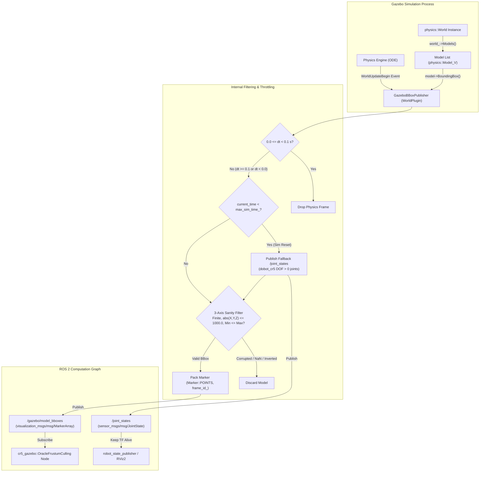
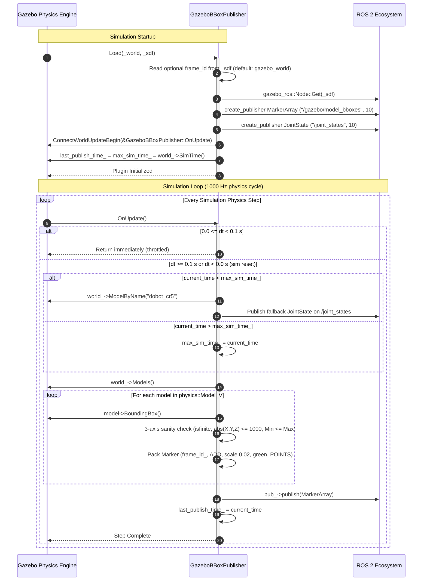

# Gazebo Bounding Box Publisher Plugin
## Ground-Truth World AABB Extraction for Robotic Perception

**Package:** `cr5_gazebo`  
**Source Code:** [`gazebo_bbox_publisher.cpp`](../src/gazebo_bbox_publisher.cpp)  
**Author:** Robotics Engineering Team  
**Date:** November 2026  

---

## Table of Contents

1. [Overview](#overview)
2. [Architectural Role](#architectural-role)
3. [Mathematical Formulation: Axis-Aligned Bounding Box (AABB)](#mathematical-formulation-axis-aligned-bounding-box-aabb)
4. [Gazebo WorldPlugin Architecture & Lifecycle](#gazebo-worldplugin-architecture--lifecycle)
5. [Physics Engine Querying & Traversal](#physics-engine-querying--traversal)
6. [Numerical Anomaly Filtering](#numerical-anomaly-filtering)
7. [Temporal Throttling and Rate Control](#temporal-throttling-and-rate-control)
8. [Simulation Time Reset & Upstream `gazebo_ros2_control` Recovery Workaround](#simulation-time-reset--upstream-gazebo_ros2_control-recovery-workaround)
9. [ROS 2 Interface & Serialization Protocol](#ros-2-interface--serialization-protocol)
10. [SDF Integration & Configuration](#sdf-integration--configuration)
11. [Verification and Diagnostic Commands](#verification-and-diagnostic-commands)
12. [Design Rationale & Limitations](#design-rationale--limitations)

---

## Overview

The `GazeboBBoxPublisher` is a native C++ system plugin for the Gazebo Classic simulator. It implements the foundational sensing layer of the **Oracle Sensor Paradigm**: instead of generating and processing computationally expensive 3D point clouds or running neural object detection networks during simulation, the system extracts the absolute geometric ground truth directly from the simulator's internal physics representation.

The plugin iterates through every physical entity instantiated in the simulation world, computes its exact **Axis-Aligned Bounding Box (AABB)** in Gazebo scene-origin coordinates (`gazebo_world`), performs full 3-axis numerical sanity filtering against corrupted or uninitialized mesh geometry, and broadcasts the bounding envelopes over ROS 2 at a controlled rate of 10 Hz. Additionally, during simulation time resets, it provides a fallback `/joint_states` recovery publisher to keep the robot TF tree active while upstream `gazebo_ros2_control` catches up. This physics-derived ground truth underpins the entire `cr5_gazebo` oracle pipeline—supporting 2D camera overlay verification, annotated ML dataset creation (training, validation, and testing), and decoupled downstream motion planning.

---

## Architectural Role

In the `cr5_gazebo` perception architecture, the plugin acts as the primary ground-truth data producer:



The plugin follows the **Single Responsibility Principle**: it extracts raw geometric bounds for *all* models without applying semantic filtering (e.g., distinguishing between plants, the robot, or tables). Semantic classification, robot-frame alignment, and camera view culling are delegated downstream to the [`OracleFrustumCulling`](oracle_frustum_culling_doc.md) node.

---

## Mathematical Formulation: Axis-Aligned Bounding Box (AABB)

In Euclidean 3D space $\mathbb{R}^3$, an **Axis-Aligned Bounding Box (AABB)** is a rectangular cuboid whose faces are constrained to be perpendicular to the Cartesian axes of the Gazebo scene-origin reference frame $\mathcal{F}_{gazebo\_world} = \{O_{gz}, \hat{\mathbf{x}}, \hat{\mathbf{y}}, \hat{\mathbf{z}}\}$.

> [!IMPORTANT]
> **Coordinate Frame Distinction (`gazebo_world` vs. TF `world`):**
> `model->BoundingBox()` returns coordinates in the Gazebo scene frame $\mathcal{F}_{gazebo\_world}$, which is **distinct** from the TF/MoveIt `"world"` frame (the URDF root link located at the robot's spawn pose, e.g., $(0.2, -0.6, 0.0)^T\text{ m}$ in Gazebo coordinates).

### Analytical Definition

An AABB is fully characterized by its minimum and maximum extreme spatial coordinates:

$$P_{\min} = \begin{bmatrix} x_{\min} \\ y_{\min} \\ z_{\min} \end{bmatrix}, \quad P_{\max} = \begin{bmatrix} x_{\max} \\ y_{\max} \\ z_{\max} \end{bmatrix} \in \mathbb{R}^3$$

where each Cartesian component satisfies:

$$x_{\min} \le x_{\max}, \quad y_{\min} \le y_{\max}, \quad z_{\min} \le z_{\max}$$

The spatial subset $\mathcal{B} \subset \mathbb{R}^3$ bounded by the envelope is defined as:

$$\mathcal{B} = \left\{ \mathbf{p} = \begin{bmatrix} x \\ y \\ z \end{bmatrix} \in \mathbb{R}^3 \;\middle|\; x \in [x_{\min}, x_{\max}], \; y \in [y_{\min}, y_{\max}], \; z \in [z_{\min}, z_{\max}] \right\}$$

### Derived Geometric Parameters

From the extremal pair $(P_{\min}, P_{\max})$, all volumetric metrics are computed algebraically:

1. **Geometric Centroid:**
   $$C = \frac{P_{\min} + P_{\max}}{2} = \begin{bmatrix} \frac{x_{\min} + x_{\max}}{2} \\ \frac{y_{\min} + y_{\max}}{2} \\ \frac{z_{\min} + z_{\max}}{2} \end{bmatrix}$$

2. **Principal Extents (Width, Depth, Height):**
   $$\mathbf{d} = P_{\max} - P_{\min} = \begin{bmatrix} \Delta x \\ \Delta y \\ \Delta z \end{bmatrix} = \begin{bmatrix} x_{\max} - x_{\min} \\ y_{\max} - y_{\min} \\ z_{\max} - z_{\min} \end{bmatrix}$$

3. **Eight Spatial Vertices:**
   $$V_{ijk} = \begin{bmatrix} (1 - i) x_{\min} + i x_{\max} \\ (1 - j) y_{\min} + j y_{\max} \\ (1 - k) z_{\min} + k z_{\max} \end{bmatrix}, \quad i, j, k \in \{0, 1\}$$

```
          V_011 ----------- V_111
          /|                /|
         / |               / |
      V_001 ----------- V_101|
        |  |              |  |
        | V_010 ----------|- V_110  (P_max = V_111)
        | /               | /
        |/                |/
      V_000 ----------- V_100
  (P_min = V_000)
```

Because an AABB is defined relative to the Gazebo scene axes, if an asymmetric mesh rotates in 3D space, its Gazebo world AABB expands or contracts to enclose the rotated geometry.

---

## Gazebo WorldPlugin Architecture & Lifecycle

The plugin is implemented as a derived class of `gazebo::WorldPlugin` and is registered with the Gazebo runtime using the `GZ_REGISTER_WORLD_PLUGIN` macro.

### Sequence Diagram



### 1. Initialization: `Load()`
The `Load(physics::WorldPtr _world, sdf::ElementPtr _sdf)` method is invoked once when Gazebo loads the simulation world:
- **World Handle:** Caches the `physics::WorldPtr` pointer to query simulation entities and simulation time.
- **Frame Identifier:** Checks `_sdf->HasElement("frame_id")`; if provided, overrides the default `frame_id_` (`"gazebo_world"`).
- **ROS 2 Node Creation:** Utilizes `gazebo_ros::Node::Get(_sdf)` to obtain a managed ROS 2 node handle integrated with Gazebo's parameter and execution context.
- **Publisher Instantiation:**
  - Creates `pub_` (`rclcpp::Publisher<visualization_msgs::msg::MarkerArray>`) on `/gazebo/model_bboxes` with queue depth 10.
  - Creates `joint_state_pub_` (`rclcpp::Publisher<sensor_msgs::msg::JointState>`) on `/joint_states` with queue depth 10 (used for simulation-reset recovery).
- **Event Binding:** Connects the callback `GazeboBBoxPublisher::OnUpdate` to the `event::Events::ConnectWorldUpdateBegin` signal.
- **Clock Synchronization:** Initializes both `last_publish_time_` and `max_sim_time_` to `world_->SimTime()`.

### 2. Update Cycle: `OnUpdate()`
Gazebo invokes `OnUpdate()` before advancing each physics integration step. The callback evaluates elapsed simulation time, handles potential backward simulation time jumps, traverses models, validates bounding boxes, and publishes messages.

---

## Physics Engine Querying & Traversal

Gazebo maintains a hierarchical model registry. The plugin queries this collection via:

```cpp
physics::Model_V models = world_->Models();
```

For each non-null model pointer in the vector, the Gazebo scene-origin bounding box is retrieved via:

```cpp
ignition::math::AxisAlignedBox world_bbox = model->BoundingBox();
const auto &bmin = world_bbox.Min();
const auto &bmax = world_bbox.Max();
```

`BoundingBox()` aggregates the bounding volumes of all child links and collision meshes attached to the model, returning the enclosing box expressed in $\mathcal{F}_{gazebo\_world}$.

---

## Numerical Anomaly Filtering

### Uninitialized Mesh & Degenerate AABB Artifacts in Gazebo

When complex collision meshes (such as high-polygon DAE or OBJ models) are dynamically loaded or contain uninitialized bounding volume trees, Gazebo can report corrupted extreme coordinates (`2e17`), `NaN`/`±Inf` values, or inverted bounding boxes (`Min > Max`).

Checking only `std::abs(bmin.X()) > 1000.0` is insufficient because:
1. Corruptions occurring exclusively on the $Y$ or $Z$ axes pass unnoticed.
2. In IEEE 754 floating-point arithmetic, comparisons involving `NaN` (`std::abs(NaN) > 1000.0`) always evaluate to **`false`**, allowing `NaN` coordinates to slip through into MoveIt2 and downstream vision projection nodes.
3. Uninitialized or empty boxes can report `Min > Max`.

### Full 3-Axis Sanity Barrier

The plugin enforces a complete 3-axis mathematical validity predicate before serializing any model:

$$\text{Valid}(M) \iff \forall a \in \{x, y, z\}:\; \text{isfinite}(b_{\min,a}) \;\land\; \text{isfinite}(b_{\max,a}) \;\land\; |b_{\min,a}| \le 1000.0 \;\land\; |b_{\max,a}| \le 1000.0 \;\land\; b_{\min,a} \le b_{\max,a}$$

```cpp
if (!std::isfinite(bmin.X()) || !std::isfinite(bmin.Y()) || !std::isfinite(bmin.Z()) ||
    !std::isfinite(bmax.X()) || !std::isfinite(bmax.Y()) || !std::isfinite(bmax.Z()) ||
    std::abs(bmin.X()) > 1000.0 || std::abs(bmin.Y()) > 1000.0 || std::abs(bmin.Z()) > 1000.0 ||
    std::abs(bmax.X()) > 1000.0 || std::abs(bmax.Y()) > 1000.0 || std::abs(bmax.Z()) > 1000.0 ||
    bmin.X() > bmax.X() || bmin.Y() > bmax.Y() || bmin.Z() > bmax.Z()) {
  continue;
}
```

Given a robotic workcell radius of $\approx 1.5\text{ m}$, any coordinate failing finiteness, exceeding $1000.0\text{ m}$ on any axis, or violating $b_{\min} \le b_{\max}$ is safely discarded.

---

## Temporal Throttling and Rate Control

Gazebo's physics step runs at a high default frequency ($1000\text{ Hz}$). Publishing bounding box data at this rate would saturate ROS 2 DDS transport queues and waste CPU cycles.

The plugin enforces 10 Hz rate limiting using Gazebo's internal simulation clock (`world_->SimTime()`):

```cpp
common::Time current_time = world_->SimTime();
double dt = (current_time - last_publish_time_).Double();
if (dt >= 0.0 && dt < 0.1) return;
last_publish_time_ = current_time;
```

Notice the `dt >= 0.0` guard:
- During normal forward simulation ($0 \le \Delta t < 0.1\text{ s}$), updates are throttled to **10 Hz** ($\Delta t \ge 0.1\text{ s}$).
- When a simulation reset causes `current_time` to jump backwards ($\Delta t < 0.0\text{ s}$), the condition `dt >= 0.0 && dt < 0.1` evaluates to `false`, allowing `last_publish_time_` to reset immediately instead of stalling the publisher until `SimTime` catches back up to the pre-reset timestamp.

---

## Simulation Time Reset & Upstream `gazebo_ros2_control` Recovery Workaround

In ROS 2 Humble, `libgazebo_ros2_control.so` contains an upstream bug in `GazeboRosControlPrivate::Update()`: if Gazebo's simulation time is reset (e.g., via *Reset Time* or *Reset World* in the GUI), `gazebo_ros2_control` stops updating all controllers—including `joint_state_broadcaster`—until `SimTime` catches back up to the highest timestamp reached prior to the reset.

Without `/joint_states`, `robot_state_publisher` stops broadcasting dynamic transforms, breaking the TF tree (`world` $\to \dots \to$ `zed_optical_link`) and freezing RViz2 and downstream perception nodes.

### Recovery Logic

The plugin tracks the high-water mark `max_sim_time_` across updates (with `sensor_msgs` linked as a package dependency):

```cpp
if (current_time > max_sim_time_) {
  max_sim_time_ = current_time;
} else if (current_time < max_sim_time_) {
  // Workaround for upstream ROS 2 Humble gazebo_ros2_control bug:
  // Publish /joint_states directly from the Gazebo robot model during this recovery window
  // so robot_state_publisher and RViz2 keep the TF tree alive.
  physics::ModelPtr robot_model = world_->ModelByName("dobot_cr5");
  if (robot_model) {
    sensor_msgs::msg::JointState js_msg;
    js_msg.header.stamp = ros_node_->now();
    for (const auto &joint : robot_model->GetJoints()) {
      if (joint && joint->DOF() > 0) {
        js_msg.name.push_back(joint->GetName());
        js_msg.position.push_back(joint->Position(0));
        js_msg.velocity.push_back(joint->GetVelocity(0));
      }
    }
    if (!js_msg.name.empty()) {
      joint_state_pub_->publish(js_msg);
    }
  }
}
```

During the recovery interval ($t_{\text{sim}} < t_{\max}$), `GazeboBBoxPublisher` queries `dobot_cr5` directly from Gazebo physics and publishes position and velocity for all actuated joints (`DOF() > 0`) at 10 Hz. Once $t_{\text{sim}}$ surpasses $t_{\max}$, `gazebo_ros2_control` resumes automatically and fallback publishing stops.

---

## ROS 2 Interface & Serialization Protocol

### Published Topic Details

| Topic Name | Message Type | Rate | QoS Profile |
|---|---|---|---|
| `/gazebo/model_bboxes` | `visualization_msgs/msg/MarkerArray` | 10 Hz | History: KeepLast(10), Reliability: Reliable |
| `/joint_states` | `sensor_msgs/msg/JointState` | 10 Hz *(during sim-time reset recovery window only)* | History: KeepLast(10), Reliability: Reliable |

### Marker Serialization Protocol

Each valid model in the simulation world is serialized into a single `visualization_msgs::msg::Marker` message within the `MarkerArray`, with complete visual attributes initialized for RViz2 compatibility:

```cpp
visualization_msgs::msg::Marker marker;
marker.header.frame_id = frame_id_;
marker.header.stamp = ros_node_->now();
marker.ns = model->GetName();
marker.id = id++;
marker.type = visualization_msgs::msg::Marker::POINTS;
marker.action = visualization_msgs::msg::Marker::ADD;
marker.scale.x = 0.02;
marker.scale.y = 0.02;
marker.color.g = 1.0f;
marker.color.a = 1.0f;

geometry_msgs::msg::Point p_min, p_max;
p_min.x = bmin.X();
p_min.y = bmin.Y();
p_min.z = bmin.Z();

p_max.x = bmax.X();
p_max.y = bmax.Y();
p_max.z = bmax.Z();

marker.points.push_back(p_min);
marker.points.push_back(p_max);

msg.markers.push_back(marker);
```

- **`marker.header.frame_id`**: Defaults to `"gazebo_world"` (or `<frame_id>` from SDF), avoiding misinterpreting scene-origin bounds as TF `"world"` (robot-centered) coordinates in RViz2.
- **`marker.ns`**: Identifies the entity by its Gazebo model name (e.g., `"pianta_00"`, `"pianta_01"`, `"ostacolo_laptop"`, `"dobot_cr5"`).
- **`marker.type = Marker::POINTS`**, **`marker.action = Marker::ADD`**: Standard point-list addition marker.
- **`marker.scale` & `marker.color`**: Explicitly initialized (`0.02` m width/height, opaque green `g=1.0, a=1.0`) so RViz2 renders the extremal corners without zero-scale or zero-alpha warnings.
- **`marker.points`**: Strictly contains exactly **two** points:
  - `points[0]` $\to P_{\min} = (x_{\min}, y_{\min}, z_{\min})^T$
  - `points[1]` $\to P_{\max} = (x_{\max}, y_{\max}, z_{\max})^T$

---

## SDF Integration & Configuration

To enable the plugin, add the `<plugin>` tag within the `<world>` element of the simulation world file (e.g., [`first_ac.world`](../worlds/first_ac.world)):

```xml
<?xml version="1.0" ?>
<sdf version="1.6">
  <world name="default">
    <!-- Gazebo ROS State Plugin -->
    <plugin name="gazebo_ros_state" filename="libgazebo_ros_state.so">
      <ros>
        <namespace>/gazebo</namespace>
      </ros>
      <update_rate>10.0</update_rate>
    </plugin>

    <!-- Gazebo Bounding Box Publisher Plugin -->
    <plugin name="gazebo_bbox_publisher" filename="libgazebo_bbox_publisher.so">
      <!-- Optional SDF parameter (defaults to "gazebo_world") -->
      <!-- <frame_id>gazebo_world</frame_id> -->
    </plugin>

    <!-- Environment lighting and models -->
    <include>
      <uri>model://sun</uri>
    </include>
    ...
  </world>
</sdf>
```

| SDF Parameter | Type | Default | Description |
|---|---|---|---|
| `<frame_id>` | `string` | `"gazebo_world"` | Frame ID assigned to `Marker::header.frame_id` on `/gazebo/model_bboxes` |

When Gazebo parses the world file, the dynamic linker resolves `libgazebo_bbox_publisher.so` from the library path and invokes `Load()`.

---

## Verification and Diagnostic Commands

### 1. Verify Publishing Rate

Confirm the plugin is publishing at the configured 10 Hz rate:

```bash
ros2 topic hz /gazebo/model_bboxes
```

Expected output:
```
average rate: 10.003
  min: 0.098s max: 0.102s std dev: 0.0012s window: 10
```

### 2. Inspect Raw Bounding Box Data

Inspect the structure, frame ID, marker attributes, and extremal coordinates:

```bash
ros2 topic echo /gazebo/model_bboxes --once
```

Sample output:
```yaml
markers:
- header:
    stamp:
      sec: 45
      nanosec: 300000000
    frame_id: gazebo_world
  ns: pianta_01
  id: 0
  type: 8
  action: 0
  scale: {x: 0.02, y: 0.02, z: 0.0}
  color: {r: 0.0, g: 1.0, b: 0.0, a: 1.0}
  points:
  - x: 0.15234
    y: 0.42189
    z: 0.00000
  - x: 0.38451
    y: 0.65406
    z: 0.41200
```

### 3. Topic Connection Status

Confirm active subscribers (e.g., `oracle_frustum_culling`):

```bash
ros2 topic info /gazebo/model_bboxes -v
```

---

## Design Rationale & Limitations

1. **Global Unfiltered Broadcasting:** The plugin publishes all models in the world (including ground planes and robot arm links). This ensures maximum decoupling: simulation geometry extraction remains general-purpose, while robot-frame conversion, object filtering, and semantic classification are handled dynamically in ROS 2 via parameters.
2. **Axis-Aligned Constraint:** Bounding boxes are strictly aligned with the Gazebo world axes ($X, Y, Z$). For tilted or slender models, simplified primitive collision geometries can inflate the enclosing AABB diagonally. In this architecture, this is mitigated by using accurate mesh collision geometries (see [`first_ac.world`](../worlds/first_ac.world)).
