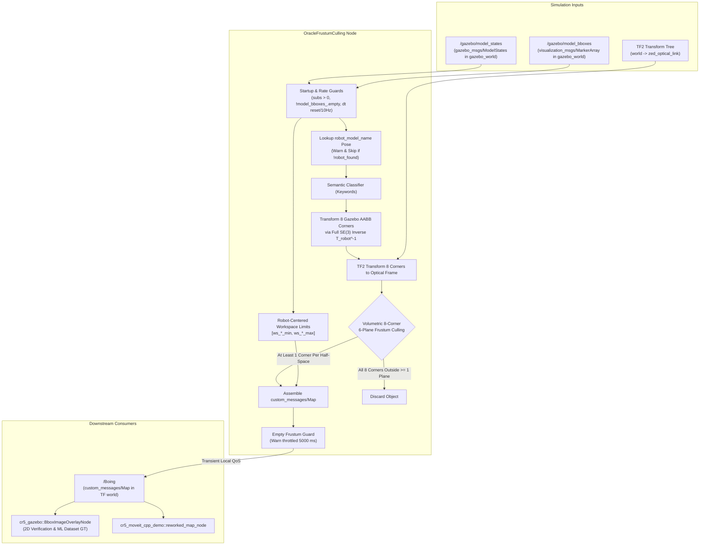
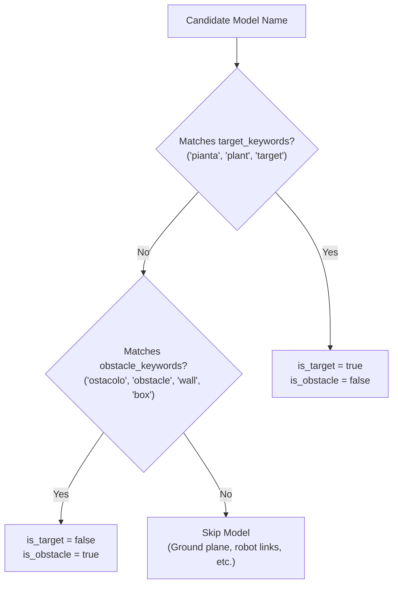

# Oracle Frustum Culling Node
## Virtual Vision Sensor and Volumetric View Frustum Projection Engine

**Package:** `cr5_gazebo`  
**Source Code:** [`oracle_frustum_culling.cpp`](../src/oracle_frustum_culling.cpp)  
**Author:** Robotics Engineering Team  
**Date:** November 2026  

---

## Table of Contents

1. [Overview & The Oracle Paradigm](#overview--the-oracle-paradigm)
2. [Architectural Role in the Perception Stack](#architectural-role-in-the-perception-stack)
3. [ROS 2 Component Architecture & QoS Configuration](#ros-2-component-architecture--qos-configuration)
4. [Full $SE(3)$ Robot Base Frame Alignment & Safety Guards](#full-se3-robot-base-frame-alignment--safety-guards)
5. [Robot-Centered Workspace Boundary Generation](#robot-centered-workspace-boundary-generation)
6. [Semantic Object Classification](#semantic-object-classification)
7. [Mathematical Formulation: Volumetric 8-Corner View Frustum Culling](#mathematical-formulation-volumetric-8-corner-view-frustum-culling)
8. [Startup Synchronization, Robustness & Performance Optimization](#startup-synchronization-robustness--performance-optimization)
9. [Message Structure & Serialization Protocol](#message-structure--serialization-protocol)
10. [ROS 2 Parameters Reference](#ros-2-parameters-reference)
11. [Diagnostics & Verification Procedures](#diagnostics--verification-procedures)

---

## Overview & The Oracle Paradigm

In robotic vision pipelines, generating dense 3D point clouds from RGB-D cameras (such as the Stereolabs ZED) and running 3D object detection or segmentation is computationally demanding, especially within real-time simulation loops.

The `OracleFrustumCulling` node implements an **Oracle Sensor Paradigm**:
- It consumes absolute ground-truth object poses and bounding boxes directly from the Gazebo simulation (`gazebo_world`).
- It transforms them via the exact inverse $SE(3)$ robot spawn pose into the robot-centered TF/MoveIt frame (`global_frame`, default `"world"`).
- It models the geometric and optical physical constraints of the on-board ZED camera using TF2 coordinate transformations and volumetric frustum intersection.
- It filters the global scene so that only objects physically intersecting the camera's **view frustum** (field of view and depth limits) are forwarded downstream.

Its camera-constrained 3D ground truth on `/Boing` serves both the primary **2D optical verification** loop ([`BboxImageOverlayNode`](bbox_image_overlay_doc.md))—validating geometric fidelity and supporting the creation of **training, validation, and testing datasets** for machine learning models—and downstream trajectory planners (such as [`reworked_map_node`](../../documentation/reworked_map_doc.md) and MoveIt2) without requiring real-time PointCloud segmentation or ML inference.

---

## Architectural Role in the Perception Stack

The node bridges raw simulation ground truth with 2D visual verification, ML dataset pipelines, and downstream motion planning:



---

## ROS 2 Component Architecture & QoS Configuration

The node is implemented as a **ROS 2 Component** using the `rclcpp_components` plugin framework:

```cpp
#include <rclcpp_components/register_node_macro.hpp>
...
RCLCPP_COMPONENTS_REGISTER_NODE(cr5_gazebo::OracleFrustumCulling)
```

This design allows the node to be executed either as a standalone process (`oracle_frustum_culling_node`) or loaded dynamically into a shared composable container (`rclcpp_components::ComponentManager`), sharing address space with other vision nodes to eliminate inter-process serialization overhead.

### Quality of Service (QoS) Strategy

The output publisher on topic `/Boing` uses a **Transient Local** durability profile with a history depth of 1:

```cpp
rclcpp::QoS pub_qos(rclcpp::KeepLast(1));
pub_qos.transient_local();
map_pub_ = this->create_publisher<custom_messages::msg::Map>("/Boing", pub_qos);
```

- **Latching Behavior:** Transient Local QoS ensures that late-joining nodes (such as `reworked_map_node`, `bbox_image_overlay_node`, or `move_cr5_node_modular` launched asynchronously) immediately receive the latest published map message upon establishing their subscription, eliminating initialization race conditions.

---

## Full $SE(3)$ Robot Base Frame Alignment & Safety Guards

### Coordinate Frame Disambiguation (`gazebo_world` vs. TF/MoveIt `world`)

Two distinct coordinate frames are commonly referred to as "world" in this system:

1. **Gazebo World (`gazebo_world`):** The scene origin of the Gazebo simulator. Both `/gazebo/model_states` poses and `/gazebo/model_bboxes` AABBs (published by [`GazeboBBoxPublisher`](gazebo_bbox_publisher_doc.md)) are expressed in this frame.
2. **TF/MoveIt World (`global_frame`, default `"world"`):** The root link of the robot URDF (`world` $\to$ `dummy_link` $\to$ `base_link`). It coincides with the Gazebo frame of the spawned robot model (e.g., positioned at $(0.2, -0.6, 0.0)^T\text{ m}$ in Gazebo coordinates).

Because `OracleFrustumCulling` converts Gazebo-world bounding boxes into the robot model frame using the inverse of the Gazebo robot pose and then queries TF from `global_frame` to `camera_frame`, `global_frame` **must** coincide with the URDF root link (`"world"`). This constraint is explicitly enforced in the `rcl_interfaces::msg::ParameterDescriptor` on `global_frame`: setting it to a child link such as `base_link` would silently misalign the resulting `/Boing` map.

### Configurable Robot Entity Lookup & Missing-Robot Guard

During each callback execution, the node looks up the robot entity specified by `robot_model_name` (default `"dobot_cr5"`) inside `/gazebo/model_states` using bounds-safe indexing (`i < msg->name.size() && i < msg->pose.size()`):

```cpp
const std::string robot_name = this->get_parameter("robot_model_name").as_string();
tf2::Transform robot_tf_inv;
robot_tf_inv.setIdentity();
bool robot_found = false;
for (size_t i = 0; i < msg->name.size() && i < msg->pose.size(); ++i) {
  if (msg->name[i] == robot_name) {
    tf2::Transform robot_tf;
    tf2::fromMsg(msg->pose[i], robot_tf);
    robot_tf_inv = robot_tf.inverse();
    robot_found = true;
    break;
  }
}
if (!robot_found) {
  RCLCPP_WARN_THROTTLE(this->get_logger(), *this->get_clock(), 2000,
    "Robot model '%s' not found in /gazebo/model_states; skipping publish.",
    robot_name.c_str());
  return;
}
```

If `!robot_found` (e.g., due to a model name mismatch or runtime entity respawn/deletion), the node logs a throttled warning (every 2000 ms) and returns early instead of silently falling back to the identity transform and publishing shifted, unaligned `/Boing` coordinates.

### Full $SE(3)$ Inverse Pose Transformation of 8 AABB Corners

Let $\mathbf{T}_{robot} \in SE(3)$ be the rigid pose of the robot model in `gazebo_world`, with rotation $\mathbf{R}_{robot} \in SO(3)$ and translation $\mathbf{t}_{robot} \in \mathbb{R}^3$. Its inverse transformation is:

$$\mathbf{T}_{robot}^{-1} = \begin{bmatrix} \mathbf{R}_{robot}^T & -\mathbf{R}_{robot}^T \mathbf{t}_{robot} \\ \mathbf{0}^T & 1 \end{bmatrix}$$

Simply subtracting translation $(\mathbf{p} - \mathbf{t}_{robot})$ or transforming only the two antipodal corners $(P_{\min}, P_{\max})$ fails whenever the robot is spawned with a non-zero orientation ($\mathbf{R}_{robot} \ne \mathbf{I}$), producing skewed or inverted bounding boxes ($P_{\min} > P_{\max}$).

Instead, the node reconstructs all **8 spatial vertices** $V_0^{\text{gz}}, \dots, V_7^{\text{gz}}$ of the Gazebo AABB (from `model_bboxes_`, or from `dummy_size_x/y/z` around `msg->pose[i].position` if plugin data for that model is absent), transforms every vertex by $\mathbf{T}_{robot}^{-1}$, and recomputes tight axis-aligned extrema in `global_frame`:

$$P_{\min}^{\text{moveit}} = \min_{c \in \{0..7\}} \left(\mathbf{T}_{robot}^{-1} V_c^{\text{gz}}\right), \qquad P_{\max}^{\text{moveit}} = \max_{c \in \{0..7\}} \left(\mathbf{T}_{robot}^{-1} V_c^{\text{gz}}\right)$$

```cpp
// Transform the 8 corners of the Gazebo AABB into the robot-centered MoveIt frame
double min_x = std::numeric_limits<double>::infinity();
double min_y = std::numeric_limits<double>::infinity();
double min_z_val = std::numeric_limits<double>::infinity();
double max_x = -std::numeric_limits<double>::infinity();
double max_y = -std::numeric_limits<double>::infinity();
double max_z_val = -std::numeric_limits<double>::infinity();

for (int c = 0; c < 8; ++c) {
  tf2::Vector3 pt_moveit = robot_tf_inv * gz_corners[c];
  min_x = std::min(min_x, pt_moveit.x());
  min_y = std::min(min_y, pt_moveit.y());
  min_z_val = std::min(min_z_val, pt_moveit.z());
  max_x = std::max(max_x, pt_moveit.x());
  max_y = std::max(max_y, pt_moveit.y());
  max_z_val = std::max(max_z_val, pt_moveit.z());
}
```

This guarantees exact, strictly ordered ($P_{\min} \le P_{\max}$) MoveIt bounding boxes regardless of robot spawn translation or yaw orientation.

---

## Robot-Centered Workspace Boundary Generation

The node populates the `work_space` field of the outgoing `custom_messages/msg/Map` message, defining the valid Cartesian bounding cube for downstream trajectory planning.

Because all objects in `out_map.objects` have already been transformed into the robot-centered `global_frame` (where the robot base sits at $(0, 0, 0)^T$ under the default xacro origin), the configured workspace limits are already expressed relative to the robot base and **must not** be shifted by the Gazebo spawn offset:

$$\text{work\_space.low\_left} = \begin{bmatrix} \text{ws\_x\_min} \\ \text{ws\_y\_min} \\ \text{ws\_z\_min} \end{bmatrix}, \quad \text{work\_space.top\_right} = \begin{bmatrix} \text{ws\_x\_max} \\ \text{ws\_y\_max} \\ \text{ws\_z\_max} \end{bmatrix}$$

```cpp
// Output is expressed in `global_frame` (robot model frame; with the default xacro
// x/y/z = 0 the robot base is at its origin).
// Workspace limits are already relative to the robot base, so no offset addition is needed.
out_map.work_space.low_left.x = this->get_parameter("ws_x_min").as_double();
out_map.work_space.low_left.y = this->get_parameter("ws_y_min").as_double();
out_map.work_space.low_left.z = this->get_parameter("ws_z_min").as_double();
out_map.work_space.top_right.x = this->get_parameter("ws_x_max").as_double();
out_map.work_space.top_right.y = this->get_parameter("ws_y_max").as_double();
out_map.work_space.top_right.z = this->get_parameter("ws_z_max").as_double();
```

Keeping `work_space` centered at $(0, 0, 0)^T$ ensures full frame consistency with `out_map.objects` and downstream reachability checks in [`reworked_map_node`](../../documentation/reworked_map_doc.md).

---

## Semantic Object Classification

Models present in Gazebo are filtered and classified into targets and obstacles based on configurable substring matching against the model name:

```cpp
auto target_kw = this->get_parameter("target_keywords").as_string_array();
auto obstacle_kw = this->get_parameter("obstacle_keywords").as_string_array();
```

### Classification Algorithm



- **Target Objects (`is_target = true`):** Objects that downstream motion planners generate inspection trajectories around (e.g., plants).
- **Obstacle Objects (`is_target = false`):** Static obstacles that the robot arm must avoid during scanning (e.g., laptops, tables, bins).
- **Unmatched Models:** Structural elements (floor, walls, robot links) are filtered out.

---

## Mathematical Formulation: Volumetric 8-Corner View Frustum Culling

Testing only the geometric centroid of an AABB against the camera frustum causes false negatives during close-range plant scanning ($20\text{ cm}$) or when large objects sit partially at the border of the camera's field of view: the centroid can fall outside the frustum while a substantial portion of the object remains visible in the frame.

To solve this, the node implements a **volumetric 8-corner, 6-plane separating half-space test**.

```
                  Near Plane (min_depth)
                     +-----------+
                    /|          /|
                   / |         / |
  Camera          /  +--------+--+
  Origin (0,0,0) +   |        |  |   Far Plane (max_depth)
                  \  |        |  |  +--------------------+
                   \ |        |  | /                    /|
                    \|        |  |/                    / |
                     +-----------+                    /  |
                                 +--------------------+--+
                                 |                    |  |
                                 |                    | /
                                 |                    |/
                                 +--------------------+
```

### 1. Spatial Transformation of All 8 Corners to Optical Frame

From the robot-aligned AABB extrema $(P_{\min}^{\text{moveit}}, P_{\max}^{\text{moveit}})$ in `global_frame`, the node constructs all 8 cuboid vertices $V_0, \dots, V_7 \in \mathbb{R}^3$.

Using the TF2 transformation tree, the node queries the rigid transformation $\mathbf{T}_{cam \leftarrow world} \in SE(3)$ from `global_frame` (`"world"`) to `camera_frame` (`"zed_optical_link"`), and transforms each vertex into camera optical coordinates:

$$\begin{bmatrix} c_{x,i} \\ c_{y,i} \\ c_{z,i} \\ 1 \end{bmatrix} = \mathbf{T}_{cam \leftarrow world} \begin{bmatrix} V_{i,x} \\ V_{i,y} \\ V_{i,z} \\ 1 \end{bmatrix}, \quad i \in \{0, \dots, 7\}$$

In the standard ROS optical coordinate convention (`zed_optical_link`):
- $+Z_{cam}$ points **forward** along the optical line of sight.
- $+X_{cam}$ points to the **right** of the image sensor.
- $+Y_{cam}$ points **downwards** towards the bottom of the image sensor.

### 2. Derivation of Default ZED Field of View

Given the Gazebo ZED depth sensor configuration (`horizontal_fov = 1.5 rad`, resolution $W \times H = 640 \times 480$), the vertical field of view follows from pinhole aspect-ratio geometry:

$$\theta_h = 1.5\text{ rad} \approx 85.94^\circ$$

$$\theta_v = 2 \arctan\!\left(\frac{H}{W} \tan\left(\frac{\theta_h}{2}\right)\right) = 2 \arctan\!\left(\frac{480}{640} \tan(0.75)\right) \approx 69.39^\circ$$

The tangent half-angles $\tan(\theta_h / 2)$ and $\tan(\theta_v / 2)$ are computed once per callback outside the model loop.

### 3. Six-Plane Separating Half-Space Culling Criterion

For each corner $i \in \{0, \dots, 7\}$ at depth $c_{z,i}$, the lateral frustum half-extents are:

$$W(c_{z,i}) = c_{z,i} \cdot \tan\left(\frac{\theta_h}{2}\right), \qquad H(c_{z,i}) = c_{z,i} \cdot \tan\left(\frac{\theta_v}{2}\right)$$

The node tests all 8 vertices against the 6 frustum boundary planes (**near**, **far**, **left**, **right**, **top**, **bottom**). An object is proven strictly outside the frustum—and therefore culled—if and only if **all 8 corners** lie simultaneously on the outside half-space of at least one plane:

$$\begin{aligned}
\text{all\_out\_near} &\iff \forall i \in \{0..7\},\; c_{z,i} < z_{\min} \\
\text{all\_out\_far} &\iff \forall i \in \{0..7\},\; c_{z,i} > z_{\max} \\
\text{all\_out\_left} &\iff \forall i \in \{0..7\},\; c_{x,i} < -W(c_{z,i}) \\
\text{all\_out\_right} &\iff \forall i \in \{0..7\},\; c_{x,i} > W(c_{z,i}) \\
\text{all\_out\_top} &\iff \forall i \in \{0..7\},\; c_{y,i} < -H(c_{z,i}) \\
\text{all\_out\_bottom} &\iff \forall i \in \{0..7\},\; c_{y,i} > H(c_{z,i})
\end{aligned}$$

```cpp
bool all_out_near = true, all_out_far = true;
bool all_out_left = true, all_out_right = true;
bool all_out_top = true, all_out_bottom = true;
bool transform_ok = true;

for (size_t c = 0; c < 8; ++c) {
  geometry_msgs::msg::PointStamped pt_global, pt_camera;
  pt_global.header.frame_id = global_frame;
  pt_global.point = corners_world[c];

  try {
    tf2::doTransform(pt_global, pt_camera, t);
  } catch (const tf2::TransformException &) {
    transform_ok = false;
    break;
  }

  double cx = pt_camera.point.x;
  double cy = pt_camera.point.y;
  double cz = pt_camera.point.z;

  double max_x_at_z = cz * tan_half_fov_h;
  double max_y_at_z = cz * tan_half_fov_v;

  if (cz >= min_z) all_out_near = false;
  if (cz <= max_z) all_out_far = false;
  if (cx >= -max_x_at_z) all_out_left = false;
  if (cx <= max_x_at_z) all_out_right = false;
  if (cy >= -max_y_at_z) all_out_top = false;
  if (cy <= max_y_at_z) all_out_bottom = false;
}

if (!transform_ok || all_out_near || all_out_far ||
    all_out_left || all_out_right || all_out_top || all_out_bottom) {
  continue;
}
```

**Conservative Guarantee:** While a small fraction of objects straddling a frustum corner may pass all 6 separating-axis tests without intersecting the frustum, this standard AABB–frustum test guarantees **zero false negatives**: no partially visible object or close-range target is ever prematurely dropped.

---

## Startup Synchronization, Robustness & Performance Optimization

The callback integrates five guards and optimizations before and after traversing the Gazebo model list:

1. **Lazy Publishing:**
   ```cpp
   if (map_pub_->get_subscription_count() == 0) {
     return;
   }
   ```
   Skips all TF lookups and geometric math when no downstream subscriber is listening to `/Boing`.

2. **Startup BBox Synchronization Guard:**
   ```cpp
   // Wait until GazeboBBoxPublisher has populated bounding boxes
   if (model_bboxes_.empty()) {
     return;
   }
   ```
   Prevents `OracleFrustumCulling` from latching an inaccurate `/Boing` map populated with `dummy_size_*` fallback boxes if `/gazebo/model_states` arrives before the first `/gazebo/model_bboxes` message at startup.

3. **10 Hz Throttling & Simulation Time Reset Recovery:**
   ```cpp
   rclcpp::Time current_time = this->now();
   double dt = (current_time - last_publish_time_).seconds();
   if (dt < 0.0) {
     tf_buffer_->clear();
   } else if (dt < 0.1) {
     return;
   }
   last_publish_time_ = current_time;
   ```
   When Gazebo resets simulation time backwards (`dt < 0.0`), the node flushes stale transforms from `tf_buffer_` and resets `last_publish_time_` immediately; during forward time (`0 <= dt < 0.1`), processing is throttled to 10 Hz.

4. **Loop-Invariant Parameter Hoisting:**
   `tan_half_fov_h`, `tan_half_fov_v`, `dummy_size_x`, `dummy_size_y`, `dummy_size_z`, and keyword arrays are read and computed once per callback outside the per-model loop.

5. **Empty-Frustum Warning Guard:**
   ```cpp
   if (out_map.objects.empty()) {
     RCLCPP_WARN_THROTTLE(this->get_logger(), *this->get_clock(), 5000,
       "No objects currently inside camera frustum; publishing empty objects list.");
   }
   map_pub_->publish(out_map);
   ```
   Alerts operators via a throttled warning (5000 ms) whenever the camera points away from all targets/obstacles, while downstream [`reworked_map_node`](../../documentation/reworked_map_doc.md) independently guards against indexing empty `objects` vectors.

---

## Message Structure & Serialization Protocol

The published message on `/Boing` is of type [`custom_messages/msg/Map`](../../custom_messages/custom_messages/msg/Map.msg):

```
BoundingBox work_space
Object[] objects
```

Each [`custom_messages/msg/Object`](../../custom_messages/custom_messages/msg/Object.msg) contains:
- `bool target`: `true` for inspection targets (plants), `false` for obstacles.
- `BoundingBox shape`: The robot-frame (`global_frame`) aligned AABB corners:
  - `geometry_msgs/Point low_left` ($P_{\min}^{\text{moveit}}$)
  - `geometry_msgs/Point top_right` ($P_{\max}^{\text{moveit}}$)
- `Circumference[] possible_trajectories`: Initialized empty; populated downstream by `reworked_map_node`.

---

## ROS 2 Parameters Reference

| Parameter Name | Data Type | Default Value | Description |
|---|---|---|---|
| `global_frame` | `string` | `"world"` | TF frame coinciding with the Gazebo frame of the robot model (URDF root link). Output boxes are expressed in this frame; do **not** set to `base_link`. |
| `camera_frame` | `string` | `"zed_optical_link"` | Camera optical reference frame |
| `robot_model_name` | `string` | `"dobot_cr5"` | Entity name in `/gazebo/model_states` used to look up $\mathbf{T}_{robot}^{-1}$ |
| `fov_horizontal_deg` | `double` | `85.94` | Horizontal field of view in degrees ($\approx 1.5\text{ rad}$ ZED sensor) |
| `fov_vertical_deg` | `double` | `69.39` | Vertical field of view in degrees ($4:3$ aspect ratio at $640 \times 480$) |
| `min_depth` | `double` | `0.10` | Near clipping distance in meters |
| `max_depth` | `double` | `8.00` | Far clipping distance in meters |
| `target_keywords` | `string[]` | `["pianta", "plant", "target"]` | Substrings identifying target models |
| `obstacle_keywords` | `string[]` | `["ostacolo", "obstacle", "wall", "box"]` | Substrings identifying obstacles |
| `ws_x_min` | `double` | `-1.0` | Workspace minimum X limit in `global_frame` (robot-centered) |
| `ws_x_max` | `double` | `1.0` | Workspace maximum X limit in `global_frame` (robot-centered) |
| `ws_y_min` | `double` | `-1.0` | Workspace minimum Y limit in `global_frame` (robot-centered) |
| `ws_y_max` | `double` | `1.0` | Workspace maximum Y limit in `global_frame` (robot-centered) |
| `ws_z_min` | `double` | `-1.0` | Workspace minimum Z limit in `global_frame` (robot-centered) |
| `ws_z_max` | `double` | `1.0` | Workspace maximum Z limit in `global_frame` (robot-centered) |
| `dummy_size_x` | `double` | `0.10` | Fallback size X in meters if Gazebo bbox is missing |
| `dummy_size_y` | `double` | `0.10` | Fallback size Y in meters if Gazebo bbox is missing |
| `dummy_size_z` | `double` | `0.20` | Fallback size Z in meters if Gazebo bbox is missing |

---

## Diagnostics & Verification Procedures

### 1. Echo Map Stream

Inspect the published objects currently intersecting the camera frustum (expressed in TF `"world"`):

```bash
ros2 topic echo /Boing --once
```

Example output:
```yaml
work_space:
  low_left: {x: -1.0, y: -1.0, z: -1.0}
  top_right: {x: 1.0, y: 1.0, z: 1.0}
objects:
- target: true
  shape:
    low_left: {x: -0.08, y: 0.45, z: 0.0}
    top_right: {x: 0.18, y: 0.71, z: 0.42}
```

### 2. Verify Dynamic Frustum Behavior

To verify that the volumetric Frustum Culling responds dynamically to camera motion:

1. Launch RViz with perception configuration:
   ```bash
   ros2 launch cr5_gazebo sim_zedgazebo_oracle_img2d.launch.py world:=first_ac.world
   ```
2. Jog the robot arm using MoveIt2 or joint commands so the camera turns away from the plants or approaches them at close range ($20\text{ cm}$).
3. Observe that partially visible objects remain present in `/Boing` as long as at least part of their 8-corner AABB volume lies inside all 6 frustum half-spaces, and disappear once completely outside the frustum.
