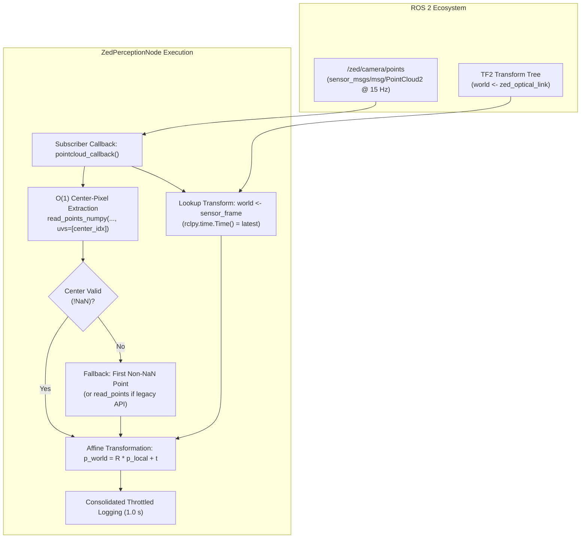

# ZED Perception Prototype Node
## PointCloud2 Deserialization and Spatial Transform Verification

**Package:** `cr5_gazebo`  
**Source Code:** [`scripts/zed_perception.py`](../scripts/zed_perception.py)  
**Author:** Robotics Engineering Team  
**Date:** November 2026  

---

## Table of Contents

1. [Overview & Role in the Workspace](#overview--role-in-the-workspace)
2. [Node Architecture](#node-architecture)
3. [Optimized PointCloud2 Data Deserialization](#optimized-pointcloud2-data-deserialization)
4. [Mathematical Formulation: Affine Spatial Transformation](#mathematical-formulation-affine-spatial-transformation)
5. [Complete Source Code Walkthrough](#complete-source-code-walkthrough)
6. [Execution and Diagnostics](#execution-and-diagnostics)
7. [Relationship to the Oracle Sensor Architecture](#relationship-to-the-oracle-sensor-architecture)

---

## Overview & Role in the Workspace

The `zed_perception.py` script is an experimental diagnostic and prototyping utility within the `cr5_gazebo` package. While the primary simulation perception pipeline relies on the high-performance **Oracle Sensor** paradigm ([`GazeboBBoxPublisher`](gazebo_bbox_publisher_doc.md) and [`OracleFrustumCulling`](oracle_frustum_culling_doc.md)), `zed_perception.py` serves two distinct development functions:

1. **Spatial Ground-Truth Verification:** Provides an independent verification tool to confirm that TF2 spatial transforms between the simulated ZED camera's optical frame (`zed_optical_link`) and the TF/MoveIt `"world"` frame are mathematically accurate.
2. **Real-World Sensor Migration Bridge:** Establishes the boilerplate pipeline for unpacking raw 3D point clouds (`sensor_msgs/msg/PointCloud2`) in preparation for future deployment on the physical Dobot CR5 robot equipped with a hardware ZED camera.

---

## Node Architecture

The node is structured as a standard Python ROS 2 node using `rclpy`:



---

## Optimized PointCloud2 Data Deserialization

ROS 2 `sensor_msgs/msg/PointCloud2` messages store point data in a binary buffer formatted according to field descriptors (`x`, `y`, `z`, `rgb`, etc.). At $640 \times 480$ resolution and $15\text{ Hz}$, each incoming frame carries **$307{,}200$ points**. Deserializing the full frame into Python structured arrays on every callback introduces heavy CPU overhead for a single-point TF check.

### $O(1)$ Center-Pixel Extraction

To keep Python overhead negligible, the node computes the flat index of the optical center pixel directly:

$$\text{center\_idx} = \begin{cases} \left\lfloor \dfrac{H}{2} \right\rfloor \cdot W + \left\lfloor \dfrac{W}{2} \right\rfloor & \text{if } H > 1 \;\land\; W > 1 \quad \text{(organized 2D cloud)} \\[8pt] 0 & \text{otherwise} \quad \text{(unorganized 1D cloud)} \end{cases}$$

Using `sensor_msgs_py.point_cloud2.read_points_numpy`, the node extracts **only that single index** via `uvs=[center_idx]` directly as an `(N, 3)` NumPy array (`float32`), bypassing structured-array allocation entirely:

```python
pts_center = pc2.read_points_numpy(msg, field_names=['x', 'y', 'z'], skip_nans=False, uvs=[center_idx])
```

### Two-Tier Fallback & Consolidated Logging

1. **NaN / Occluded Center Fallback:** If the center pixel returns `NaN` (e.g., pointing at empty sky or closer than `min_depth = 0.1 m`), the node falls back to scanning with `skip_nans=True` and selects the first valid 3D point.
2. **API Compatibility Fallback:** If `read_points_numpy` is unavailable in an older `sensor_msgs_py` version (`hasattr(pc2, 'read_points_numpy')` is `False`), it seamlessly falls back to `pc2.read_points` using the same `uvs=[center_idx]` and `NaN` fallback logic.
3. **Consolidated Throttled Logging (`1 Hz`):** All 5 diagnostic lines are formatted into a single multi-line log message emitted with `throttle_duration_sec=1.0` (with matching 1 Hz throttling on TF lookup warnings), preventing terminal flooding at 15 Hz.

---

## Mathematical Formulation: Affine Spatial Transformation

A point observed by the camera sensor is initially represented in the local camera coordinate frame $\mathcal{F}_{sensor}$ (`zed_optical_link`):

$$\mathbf{p}_{local} = \begin{bmatrix} x_{local} \\ y_{local} \\ z_{local} \end{bmatrix} \in \mathbb{R}^3$$

To express this point in the TF/MoveIt robot-centered global frame $\mathcal{F}_{world}$ (`target_frame = 'world'`, i.e., the URDF root link—**not** Gazebo's scene-origin `gazebo_world`), the node retrieves the rigid transformation $(\mathbf{R}, \mathbf{t}) \in SE(3)$ from TF2 using `rclpy.time.Time()` (time zero = latest available transform, avoiding extrapolation mismatches):

### 1. Translation Vector

$$\mathbf{t} = \begin{bmatrix} t_x \\ t_y \\ t_z \end{bmatrix}$$

### 2. Quaternion to Rotation Matrix Conversion

The orientation is represented as a unit quaternion:

$$\mathbf{q} = \begin{bmatrix} q_x & q_y & q_z & q_w \end{bmatrix}^T, \quad \|\mathbf{q}\| = 1$$

Using `scipy.spatial.transform.Rotation`, the quaternion is converted to a $3 \times 3$ orthogonal rotation matrix $\mathbf{R} \in SO(3)$:

$$\mathbf{R}(\mathbf{q}) = \begin{bmatrix}
1 - 2(q_y^2 + q_z^2) & 2(q_x q_y - q_z q_w) & 2(q_x q_z + q_y q_w) \\
2(q_x q_y + q_z q_w) & 1 - 2(q_x^2 + q_z^2) & 2(q_y q_z - q_x q_w) \\
2(q_x q_z - q_y q_w) & 2(q_y q_z + q_x q_w) & 1 - 2(q_x^2 + q_y^2)
\end{bmatrix}$$

### 3. Affine Forward Transformation

The global coordinates $\mathbf{p}_{world}$ are computed via affine matrix multiplication:

$$\mathbf{p}_{world} = \mathbf{R} \cdot \mathbf{p}_{local} + \mathbf{t}$$

$$\begin{bmatrix} x_{world} \\ y_{world} \\ z_{world} \end{bmatrix} = \begin{bmatrix} R_{11} & R_{12} & R_{13} \\ R_{21} & R_{22} & R_{23} \\ R_{31} & R_{32} & R_{33} \end{bmatrix} \begin{bmatrix} x_{local} \\ y_{local} \\ z_{local} \end{bmatrix} + \begin{bmatrix} t_x \\ t_y \\ t_z \end{bmatrix}$$

---

## Complete Source Code Walkthrough

Below is the complete implementation of [`scripts/zed_perception.py`](../scripts/zed_perception.py):

```python
#!/usr/bin/env python3

import rclpy
from rclpy.node import Node
from sensor_msgs.msg import PointCloud2
from tf2_ros import Buffer, TransformListener
import tf2_ros
import numpy as np
from scipy.spatial.transform import Rotation
import sensor_msgs_py.point_cloud2 as pc2

class ZedPerceptionNode(Node):
    def __init__(self):
        super().__init__('zed_perception_node')
        
        self.tf_buffer = Buffer()
        self.tf_listener = TransformListener(self.tf_buffer, self)
        
        self.subscription = self.create_subscription(
            PointCloud2,
            '/zed/camera/points',
            self.pointcloud_callback,
            10)

    def pointcloud_callback(self, msg):
        sensor_frame = msg.header.frame_id
        target_frame = 'world'

        try:
            # Lookup TF using Time() (Time 0 = latest available transform)
            # to avoid extrapolation issues or timestamp skew
            transform = self.tf_buffer.lookup_transform(
                target_frame, 
                sensor_frame, 
                rclpy.time.Time(),
                rclpy.duration.Duration(seconds=0.2)
            )
            
            trans = transform.transform.translation
            rot = transform.transform.rotation

            # Optimization: instead of deserializing all 307,200 points at 15 Hz,
            # read only the center pixel first via 'uvs'.
            if msg.height > 1 and msg.width > 1:
                center_idx = (msg.height // 2) * msg.width + (msg.width // 2)
            else:
                center_idx = 0

            p_local = None
            if hasattr(pc2, 'read_points_numpy'):
                # Direct NumPy array access (N, 3), avoiding structured array overhead
                pts_center = pc2.read_points_numpy(msg, field_names=['x', 'y', 'z'], skip_nans=False, uvs=[center_idx])
                if len(pts_center) > 0 and not np.isnan(pts_center[0]).any():
                    p_local = pts_center[0].astype(float)
                else:
                    # Fallback to first valid point if center is NaN (e.g. out of range/occluded)
                    pts_all = pc2.read_points_numpy(msg, field_names=['x', 'y', 'z'], skip_nans=True)
                    if len(pts_all) > 0:
                        p_local = pts_all[0].astype(float)
            else:
                pts_center = pc2.read_points(msg, field_names=('x', 'y', 'z'), skip_nans=False, uvs=[center_idx])
                if len(pts_center) > 0 and not (np.isnan(pts_center[0]['x']) or np.isnan(pts_center[0]['y']) or np.isnan(pts_center[0]['z'])):
                    p_local = np.array([float(pts_center[0]['x']), float(pts_center[0]['y']), float(pts_center[0]['z'])])
                else:
                    punti_array = pc2.read_points(msg, field_names=("x", "y", "z"), skip_nans=True)
                    if len(punti_array) > 0:
                        p_local = np.array([float(punti_array[0]['x']), float(punti_array[0]['y']), float(punti_array[0]['z'])])

            if p_local is None:
                return

            r = Rotation.from_quat([rot.x, rot.y, rot.z, rot.w]) # scipy rotation
            matrice_rotazione = r.as_matrix()
            vettore_traslazione = np.array([trans.x, trans.y, trans.z])
            p_world = matrice_rotazione.dot(p_local) + vettore_traslazione

            # Consolidated output with throttling to avoid flooding the console at 15 Hz
            log_msg = (
                f"La ZED si trova a X:{trans.x:.2f}, Y:{trans.y:.2f}, Z:{trans.z:.2f} rispetto al mondo.\n"
                f"--- TEST SINGOLO PUNTO ---\n"
                f"Visto dalla ZED:   X={p_local[0]:.3f}, Y={p_local[1]:.3f}, Z={p_local[2]:.3f}\n"
                f"Posizione world:   X={p_world[0]:.3f}, Y={p_world[1]:.3f}, Z={p_world[2]:.3f}\n"
                f"--------------------------"
            )
            self.get_logger().info(log_msg, throttle_duration_sec=1.0)

            # TO DO
            pass

        except tf2_ros.TransformException as ex:
            self.get_logger().warn(
                f'Impossibile ottenere la TF tra {target_frame} e {sensor_frame}: {ex}',
                throttle_duration_sec=1.0
            )
            return

def main(args=None):
    rclpy.init(args=args)
    node = ZedPerceptionNode()
    rclpy.spin(node)
    node.destroy_node()
    rclpy.shutdown()

if __name__ == '__main__':
    main()
```

---

## Execution and Diagnostics

### Running the Node

The script is installed as an executable program in `lib/cr5_gazebo` (with runtime dependencies `rclpy`, `sensor_msgs_py`, `python3-numpy`, and `python3-scipy` declared in `package.xml`). It can be run directly via `ros2 run`:

```bash
ros2 run cr5_gazebo zed_perception.py
```

When running against Gazebo simulation time, pass `--ros-args -p use_sim_time:=true`.

### Sample Output Log

```
[INFO] [zed_perception_node]: La ZED si trova a X:0.25, Y:0.92, Z:0.58 rispetto al mondo.
--- TEST SINGOLO PUNTO ---
Visto dalla ZED:   X=-0.021, Y=0.045, Z=0.620
Posizione world:   X=0.232, Y=1.325, Z=0.312
--------------------------
```

---

## Relationship to the Oracle Sensor Architecture

| Feature | Oracle Sensor Pipeline (`OracleFrustumCulling`) | Experimental PointCloud Node (`zed_perception.py`) |
|---|---|---|
| **Primary Data Source** | Gazebo physics state (`ModelStates` + `model_bboxes`) | Gazebo ray-traced depth sensor (`PointCloud2` @ 15 Hz) |
| **Computational Cost** | Ultra-low ($\approx 0.05\text{ ms}$) | High upstream Gazebo ray-casting + memory transfer; **$O(1)$ center-pixel extraction** via `uvs` + `read_points_numpy` in Python (full scan fallback only when center pixel is `NaN`), with 1 Hz throttled logging |
| **Output Data** | Clean 3D Bounding Boxes (`custom_messages/Map` in TF `"world"`) | Sampled 3D point coordinate verification log |
| **Primary Use Case** | Verified 3D/2D Gazebo ground truth (2D overlay validation, ML train/val/test dataset creation, and decoupled motion planning) | TF validation and future hardware driver prototyping |
