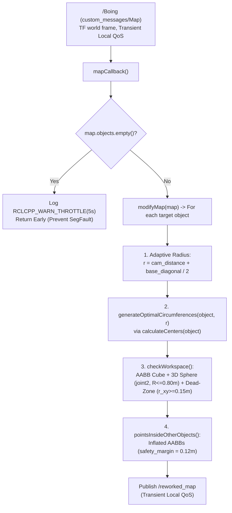

# ReworkedMap Node Documentation
## Path Planning and Trajectory Optimization for Robot Vision Systems

**Package:** `cr5_moveit_cpp_demo`  
**Source Code:** [`reworked_map.cpp`](../cr5_moveit_cpp_demo/src/external/reworked_map.cpp)  
**ROS 2 Dobot CR5 Project**  
**Date:** November 2026  

---

## Table of Contents

1. [Introduction](#introduction)
2. [Global Configuration Parameters](#global-configuration-parameters)
3. [Class Architecture](#class-architecture)
4. [Core Processing Functions](#core-processing-functions)
5. [Processing Pipeline](#processing-pipeline)
6. [Optimization Strategy](#optimization-strategy)
7. [Visualization and Debugging](#visualization-and-debugging)
8. [Performance Considerations](#performance-considerations)
9. [Future Enhancements](#future-enhancements)
10. [Integration with Robot Control](#integration-with-robot-control)
11. [Error Handling and Robustness](#error-handling-and-robustness)
12. [Conclusion](#conclusion)

---

## Introduction

The `reworked_map` node (`map_processor_node` in C++, typically launched under node name `reworked_map_node` with `use_sim_time: True`) is a critical component of the Dobot CR5 robot vision system. It processes environmental maps and generates optimal camera positioning trajectories for autonomous object scanning. This node receives raw perceptual maps, computes adaptive circular viewpoints around target objects, and evaluates every viewpoint against workspace boundaries, kinematic reachability limits, and inflated obstacle safety envelopes.

### Purpose

The primary purpose of this node is to:
- Process incoming environmental maps from the virtual or physical perception stack
- Generate adaptive multi-level circular trajectories scaled dynamically to each target object's footprint
- Evaluate trajectory points for Cartesian workspace containment, 3D spherical kinematic reachability, and inner base dead-zone avoidance
- Filter viewpoints colliding with safety-margin-inflated obstacles
- Publish optimized maps with feasible camera positions for motion execution

### System Architecture

The node operates as a middleware component between perception data on `/Boing` (produced in simulation by [`OracleFrustumCulling`](../cr5_gazebo/docs/oracle_frustum_culling_doc.md)) and the modular motion planner (`move_cr5_node_modular` / `PlantScanner` documented in [`modular_scanning_doc.md`](modular_scanning_doc.md)), exchanging [`custom_messages/msg/Map`](../custom_messages/custom_messages/msg/Map.msg) messages on `/reworked_map`.

All spatial coordinates in `/Boing` and `/reworked_map` are expressed in the **robot-centered TF `"world"` frame** (URDF root link coinciding with `base_link` under default zero spawn offset in xacro), **not** Gazebo's scene-origin `gazebo_world` frame (see [`cr5_gazebo_doc.md`](../cr5_gazebo/docs/cr5_gazebo_doc.md)).



---

## Global Configuration Parameters

### Trajectory & Perception Constants

```cpp
double cam_distance = 0.2;           // Radial optical standoff distance from target bounding diagonal (meters)
int num_points = 64;                 // Number of candidate viewpoints per circumference
double field_of_vision_z = 0.2;      // Vertical camera coverage segment height (meters)
double tolerance = 0.05;             // Vertical tolerance for field-of-vision division rounding (meters)
```

In addition, local kinematic reachability and safety clearance constants are defined inside `checkWorkspace()` and `pointsInsideOtherObjects()`:

| Constant | Value | Location | Description |
|---|---|---|---|
| `cam_distance` | `0.2` m | Global | Base standoff distance added to half the target's horizontal bounding-box diagonal |
| `num_points` | `64` | Global | Angular sampling density per circle ($5.625^\circ$ step) |
| `field_of_vision_z` | `0.2` m | Global | Vertical height covered per circular scan level |
| `tolerance` | `0.05` m | Global | Vertical overshoot tolerance before adding an extra scan level |
| `shoulder_x`, `shoulder_y`, `shoulder_z` | `0.0, 0.0, 0.147` m | `checkWorkspace()` | Position of Dobot CR5 shoulder joint (`joint2`) in `base_link` / TF `"world"` |
| `max_reach` | `0.80` m | `checkWorkspace()` | Effective 3D spherical reach radius from `joint2` under camera-pointing orientation constraints |
| `min_r_xy` | `0.15` m | `checkWorkspace()` | Inner cylindrical dead-zone radius around the robot base vertical axis |
| `safety_margin` | `0.12f` m | `pointsInsideOtherObjects()` | Isotropic AABB expansion margin protecting the robot wrist and mounted ZED camera |

#### Adaptive Standoff (`cam_distance`)
Instead of a fixed hardcoded circle radius, `modifyMap()` uses `cam_distance = 0.20 m` as a radial clearance beyond the object's bounding footprint (`base_diagonal / 2.0`). This ensures sufficient standoff for camera focus and wrist/ZED clearance (`cam_distance = 0.20 m > safety_margin = 0.12 m`) regardless of target plant width.

#### Point Density (`num_points`)
Sampling `64` points per circumference provides an angular resolution of $\frac{360^\circ}{64} = 5.625^\circ$, balancing smooth boundary-following trajectories with fast feasibility filtering.

#### Field of Vision (`field_of_vision_z` and `tolerance`)
The `field_of_vision_z` parameter (`0.20 m`) defines the vertical camera slice height used to determine whether a single circumference suffices or whether multiple stacked scan rings are needed for taller targets.

---

## Class Architecture

### MapProcessorNode Class

```cpp
class MapProcessorNode : public rclcpp::Node
{
public:
    MapProcessorNode()
    : Node("map_processor_node")
    {
        // QoS configuration for the subscriber (latching)
        rclcpp::QoS sub_qos(rclcpp::KeepLast(1));
        sub_qos.transient_local();

        map_subscriber_ = this->create_subscription<custom_messages::msg::Map>(
            "Boing",
            sub_qos,
            std::bind(&MapProcessorNode::mapCallback, this, std::placeholders::_1)
        );

        // QoS configuration for the publisher (latching)
        rclcpp::QoS pub_qos(rclcpp::KeepLast(1));
        pub_qos.transient_local();

        map_publisher_ = this->create_publisher<custom_messages::msg::Map>("reworked_map", pub_qos);
    }

private:
    rclcpp::Subscription<custom_messages::msg::Map>::SharedPtr map_subscriber_;
    rclcpp::Publisher<custom_messages::msg::Map>::SharedPtr map_publisher_;
    void mapCallback(const custom_messages::msg::Map::SharedPtr msg);
};
```

#### Constructor & QoS Logic
- **Node Name:** Instantiated natively as `"map_processor_node"` in C++ (commonly remapped/named `reworked_map_node` by launch configurations such as `sim_zedgazebo_full_auto.launch.py`, with `use_sim_time: True`).
- **Subscriber QoS (`/Boing`):** `KeepLast(1)` with `transient_local()` durability, matching `OracleFrustumCulling`'s latching publisher so late-joining subscribers always receive the latest perceptual map.
- **Publisher QoS (`/reworked_map`):** `KeepLast(1)` with `transient_local()` durability, ensuring downstream motion planners receive the latest processed trajectory map regardless of startup order.

#### Callback Mechanism (`mapCallback`)
When a new [`Map`](../custom_messages/custom_messages/msg/Map.msg) message arrives on `/Boing`, `mapCallback`:
1. Logs a throttled info message (`RCLCPP_INFO_THROTTLE` every `5000 ms`) to avoid 10 Hz console spam.
2. Copies the incoming message into the global `map` buffer.
3. **Empty Map Guard:** Checks `if (map.objects.empty())`; if true (e.g., camera pointing away from all objects), emits a throttled warning (`RCLCPP_WARN_THROTTLE` every `5000 ms`) and returns early without reprocessing or publishing, preventing out-of-bounds indexing on `map.objects[0]`.
4. Invokes `modifyMap(map)` to compute adaptive circumferences and evaluate feasibility constraints.
5. Publishes the updated `map` onto `/reworked_map`.
6. Executes a post-publish no-op traversal over `map.objects[0].possible_trajectories` (the legacy 2D ASCII grid visualization block is currently commented out; see [Visualization and Debugging](#visualization-and-debugging)).
7. Logs completion via `RCLCPP_INFO_THROTTLE` (`5000 ms`).

---

## Core Processing Functions

### `generateOptimalCircumferences` Function

```cpp
void generateOptimalCircumferences(custom_messages::msg::Object& plant, double radius) {
    std::vector<geometry_msgs::msg::Point> plant_centers = calculateCenters(plant);
    double angle_increment = 2.0 * M_PI / num_points;

    for (auto target_center : plant_centers) {
        std::vector<custom_messages::msg::OptimalPoint> circumference_size(num_points);
        custom_messages::msg::Circumference trajectory;
        trajectory.circumference = circumference_size;

        for (int j = 0; j < num_points; ++j) {
            double angle = j * angle_increment;
            trajectory.circumference[j].point.x = target_center.x + radius * cos(angle);
            trajectory.circumference[j].point.y = target_center.y + radius * sin(angle);
            trajectory.circumference[j].point.z = target_center.z;
            trajectory.circumference[j].optimality = 1.0; // Initially set all points as optimal (1)
        }
        plant.possible_trajectories.push_back(trajectory);
    }
}
```

#### Mathematical Foundation
For each horizontal slice center $(x_{\text{center}}, y_{\text{center}}, z_{\text{center}})^T$ produced by `calculateCenters(plant)`, the function generates $n = \text{num\_points} = 64$ waypoints evenly distributed along a circle of adaptive radius $r$ (passed from `modifyMap`):

$$x_j = x_{\text{center}} + r \cos(\theta_j), \quad y_j = y_{\text{center}} + r \sin(\theta_j), \quad z_j = z_{\text{center}}$$

where $\theta_j = \frac{2\pi j}{n}$ for $j \in \{0, 1, \dots, n - 1\}$. All points start with `optimality = 1.0`.

---

### `calculateCenters` Function

```cpp
std::vector<geometry_msgs::msg::Point> calculateCenters(custom_messages::msg::Object& plant) {
    geometry_msgs::msg::Point low_left = plant.shape.low_left;
    geometry_msgs::msg::Point top_right = plant.shape.top_right;

    double height = top_right.z - low_left.z;
    std::vector<geometry_msgs::msg::Point> centers;

    if (height <= field_of_vision_z + tolerance) {
        // Only one center
        geometry_msgs::msg::Point center;
        center.x = top_right.x - (top_right.x - low_left.x) / 2.0;
        center.y = top_right.y - (top_right.y - low_left.y) / 2.0;
        center.z = top_right.z + (0.2) * field_of_vision_z;
        centers.push_back(center);
    } else {
        // Calculate the number of required divisions
        int num_divisions = height / field_of_vision_z;
        if (height - (num_divisions * field_of_vision_z) > tolerance) {
            num_divisions++;
        }

        for (int i = 0; i < num_divisions; i++) {
            geometry_msgs::msg::Point center;
            center.x = top_right.x - (top_right.x - low_left.x) / 2.0;
            center.y = top_right.y - (top_right.y - low_left.y) / 2.0;

            if (i != 0) {
                center.z = top_right.z - (i + 0.5) * field_of_vision_z;
            } else {
                center.z = top_right.z + (0.25) * field_of_vision_z;
            }
            centers.push_back(center);
        }
    }
    return centers;
}
```

#### Adaptive Vertical Slicing Strategy

Let $h = z_{\text{top}} - z_{\text{low}}$ be the vertical height of the object's bounding box, $f_z = \text{field\_of\_vision\_z}$, and $\varepsilon = \text{tolerance}$. Both cases center the circle horizontally at:

$$x_{\text{center}} = \frac{x_{\text{low}} + x_{\text{top}}}{2}, \qquad y_{\text{center}} = \frac{y_{\text{low}} + y_{\text{top}}}{2}$$

1. **Small Objects ($h \le f_z + \varepsilon$):**
   A single scan circumference is placed slightly above the top of the bounding box:
   $$z_{\text{center}} = z_{\text{top}} + 0.2 \cdot f_z$$

2. **Tall Objects ($h > f_z + \varepsilon$):**
   The number of vertical scan levels $n$ uses integer floor division plus tolerance rounding:
   $$n = \left\lfloor \frac{h}{f_z} \right\rfloor + \mathbb{I}\!\left( h - \left\lfloor \frac{h}{f_z} \right\rfloor f_z > \varepsilon \right)$$
   where $\mathbb{I}(\cdot)$ is the indicator function ($1$ if true, $0$ otherwise). Vertical heights follow a top-down schedule for $i \in \{0, \dots, n - 1\}$:
   $$z_{\text{center}}(i) = \begin{cases}
   z_{\text{top}} + 0.25 \cdot f_z & \text{if } i = 0 \text{ (topmost overview ring)} \\
   z_{\text{top}} - (i + 0.5) \cdot f_z & \text{if } i > 0 \text{ (lower vertical segments)}
   \end{cases}$$

---

### `checkWorkspace` Function

```cpp
void checkWorkspace(custom_messages::msg::Object& plant, const custom_messages::msg::Map& map) {
    custom_messages::msg::BoundingBox ws_limits = map.work_space;
    geometry_msgs::msg::Point low = ws_limits.low_left;
    geometry_msgs::msg::Point top = ws_limits.top_right;

    // Dobot CR5 shoulder joint (joint2) is at (0.0, 0.0, 0.147) in base_link frame.
    // Dobot CR5 effective reach with camera pointing orientation is ~0.80 m;
    // inner dead-zone around base axis is r_xy < 0.15 m.
    const double shoulder_x = 0.0;
    const double shoulder_y = 0.0;
    const double shoulder_z = 0.147;
    const double max_reach = 0.80;
    const double min_r_xy = 0.15;

    for (auto& trajectory : plant.possible_trajectories) {
        for (auto& point : trajectory.circumference) {
            if (point.optimality != 0.0) {
                if (point.point.x < low.x || point.point.x > top.x ||
                    point.point.y < low.y || point.point.y > top.y ||
                    point.point.z < low.z || point.point.z > top.z) {
                    point.optimality = 0.0; // Mark as non-optimal
                    continue;
                }

                // 3D spherical reachability filter centered at Dobot CR5 shoulder joint2
                double dx = point.point.x - shoulder_x;
                double dy = point.point.y - shoulder_y;
                double dz = point.point.z - shoulder_z;
                double dist_shoulder = std::sqrt(dx * dx + dy * dy + dz * dz);
                double r_xy = std::sqrt(point.point.x * point.point.x + point.point.y * point.point.y);

                if (dist_shoulder > max_reach || r_xy < min_r_xy) {
                    point.optimality = 0.0; // Mark as non-optimal
                }
            }
        }
    }
}
```

#### Two-Stage Reachability Validation
Testing only the Cartesian bounding cube `map.work_space` ($[-1, 1]^3\text{ m}$) is insufficient for a 6-DOF articulated manipulator: points up to $1.033\text{ m}$ from the shoulder joint (`joint2`) lie inside the $[-1, 1]^3$ cube yet exceed the Dobot CR5 kinematic envelope when enforcing camera-pointing end-effector orientations, causing `PlantScanner` to skip boundary detection (`PHASE-1`) and fail dozens of consecutive OMPL plans.

A candidate viewpoint $\mathbf{p} = (p_x, p_y, p_z)^T$ remains feasible if and only if it passes **both** stages:

1. **Cartesian Bounding Cube Check:**
   $$(x_{\text{low}} \le p_x \le x_{\text{top}}) \;\land\; (y_{\text{low}} \le p_y \le y_{\text{top}}) \;\land\; (z_{\text{low}} \le p_z \le z_{\text{top}})$$

2. **3D Spherical Reachability & Inner Cylindrical Dead-Zone:**
   Centered at the Dobot CR5 shoulder (`joint2`) $\mathbf{s} = (0.0, 0.0, 0.147)^T\text{ m}$ in `base_link` / TF `"world"`:
   $$d_{\text{shoulder}}(\mathbf{p}) = \|\mathbf{p} - \mathbf{s}\|_2 = \sqrt{(p_x - 0.0)^2 + (p_y - 0.0)^2 + (p_z - 0.147)^2} \le R_{\max} = 0.80\text{ m}$$
   $$r_{xy}(\mathbf{p}) = \sqrt{p_x^2 + p_y^2} \ge r_{\min} = 0.15\text{ m}$$

Viewpoints failing either inequality are irreversibly marked `optimality = 0.0`.

---

### `pointsInsideOtherObjects` Function

```cpp
void pointsInsideOtherObjects(custom_messages::msg::Object& plant, const custom_messages::msg::Map& map) {
    const float safety_margin = 0.12f;

    for (auto& object : map.objects) {
        for (auto& trajectory : plant.possible_trajectories) {
            for (auto& point : trajectory.circumference) {
                if (point.optimality != 0.0) {
                    float low_x = object.shape.low_left.x - safety_margin;
                    float low_y = object.shape.low_left.y - safety_margin;
                    float low_z = object.shape.low_left.z - safety_margin;
                    float top_x = object.shape.top_right.x + safety_margin;
                    float top_y = object.shape.top_right.y + safety_margin;
                    float top_z = object.shape.top_right.z + safety_margin;

                    if (point.point.x >= low_x && point.point.x <= top_x &&
                        point.point.y >= low_y && point.point.y <= top_y &&
                        point.point.z >= low_z && point.point.z <= top_z) {
                        point.optimality = 0.0; // Mark as non-optimal
                    }
                }
            }
        }
    }
}
```

#### Inflated AABB Collision Avoidance Strategy
Every object's bounding box in `map.objects` is isotropically expanded on all three axes by `safety_margin = 0.12f` m ($12\text{ cm}$), providing physical clearance for the robot wrist and the mounted ZED camera body around `Link6`:

$$\text{Collision}(\mathbf{p}, \mathcal{O}) \iff \forall a \in \{x, y, z\}:\quad b_{\min, a}^{\mathcal{O}} - 0.12 \le p_a \le b_{\max, a}^{\mathcal{O}} + 0.12$$

**Conservative Self-Inclusion & Standoff Compatibility:** Because `if (&object != &plant)` is commented out, this function checks viewpoints against *all* scene objects—including the target plant's own inflated AABB. Since `cam_distance = 0.20 m` strictly exceeds `safety_margin = 0.12 m`, viewpoints positioned radially beyond the target's footprint remain safely outside its inflated envelope while any accidentally close or intersecting viewpoints are conservatively rejected.

---

## Processing Pipeline

### `modifyMap` Function

```cpp
void modifyMap(custom_messages::msg::Map& map) {
    for (auto& object : map.objects) {
        if (object.target) {
            // Calculate base diagonal and add it to radius
            geometry_msgs::msg::Point low_left = object.shape.low_left;
            geometry_msgs::msg::Point top_right = object.shape.top_right;
            double width = top_right.x - low_left.x;
            double depth = top_right.y - low_left.y;
            double base_diagonal = sqrt(width * width + depth * depth);
            
            double radius = cam_distance + base_diagonal / 2.0; // Add half diagonal as safety margin
            generateOptimalCircumferences(object, radius);
            checkWorkspace(object, map);
            pointsInsideOtherObjects(object, map);
        }
    }
}
```

#### Adaptive Horizontal Radius Calculation
For each object flagged with `object.target == true`, `modifyMap()` computes the horizontal footprint diagonal of its AABB and sets the scanning circle radius to half that diagonal plus `cam_distance`:

$$D_{\text{base}} = \sqrt{(x_{\text{top}} - x_{\text{low}})^2 + (y_{\text{top}} - y_{\text{low}})^2}, \qquad r = d_{\text{cam}} + \frac{D_{\text{base}}}{2}$$

Because the AABB's half-diagonal is the maximum horizontal distance from its center to any corner of its base, setting $r = d_{\text{cam}} + D_{\text{base}} / 2$ guarantees that every point on the circle maintains at least $d_{\text{cam}} = 0.20\text{ m}$ radial standoff from the entire bounding box footprint.

#### Sequential Filtering Order
1. **Adaptive Generation (`generateOptimalCircumferences`):** Creates multi-level circles at radius $r$, initializing all points to `optimality = 1.0`.
2. **Workspace & Kinematic Reachability (`checkWorkspace`):** Rejects points outside `map.work_space`, beyond $0.80\text{ m}$ of `joint2`, or inside the $0.15\text{ m}$ base dead-zone.
3. **Inflated Collision Filtering (`pointsInsideOtherObjects`):** Rejects points inside any scene object's $0.12\text{ m}$-inflated AABB.

---

## Optimization Strategy

### Binary Optimality Model

The node assigns a binary feasibility score to every candidate viewpoint $\mathbf{p}$:

$$\text{optimality}(\mathbf{p}) = \begin{cases}
1.0 & \text{if } \mathbf{p} \text{ satisfies workspace cube, kinematic sphere/dead-zone, and inflated collision clearance} \\
0.0 & \text{if } \mathbf{p} \text{ violates any constraint}
\end{cases}$$

### Constraint Hierarchy

1. **Hard Cartesian Cube (`map.work_space`):** Enforces operator-configured bounds around the robot base.
2. **Kinematic Reachability Envelope (`checkWorkspace`):** Enforces $d_{\text{shoulder}} \le 0.80\text{ m}$ and $r_{xy} \ge 0.15\text{ m}$ for `joint2` orientation feasibility.
3. **Inflated Obstacle Clearance (`pointsInsideOtherObjects`):** Enforces a $0.12\text{ m}$ buffer around all objects for wrist/ZED protection.

---

## Visualization and Debugging

### Legacy 2D ASCII Grid (Currently Disabled)

`reworked_map.cpp` contains an embedded `41 x 41` ASCII grid projection routine inside `mapCallback()` (lines 71–111) scaled by `cam_distance`:

$$x_{\text{grid}} = \text{center\_grid} + \text{round}\!\left(x_{\text{world}} \cdot \frac{\text{grid\_size} - 1}{2 \cdot d_{\text{cam}}}\right), \qquad y_{\text{grid}} = \text{center\_grid} + \text{round}\!\left(y_{\text{world}} \cdot \frac{\text{grid\_size} - 1}{2 \cdot d_{\text{cam}}}\right)$$

In the current production implementation, **this grid-rendering block is commented out** to prevent console I/O flooding at the 10 Hz `/Boing` update rate; `mapCallback()` retains a minimal post-publish loop over `map.objects[0].possible_trajectories` using `(void)point;` to silence unused-variable compiler warnings. Uncommenting lines 71–110 restores terminal ASCII plots for offline single-frame debugging.

---

## Performance Considerations

### Computational Complexity

For $n$ target objects, $m$ vertical circumferences per target, $p = 64$ points per circumference, and $o$ total scene objects:

$$\mathcal{O}(n \cdot m \cdot p \cdot (1 + o))$$

Per-point reachability checks ($d_{\text{shoulder}}, r_{xy}$) and inflated AABB bounds tests execute in $\mathcal{O}(1)$ floating-point operations. Because `OracleFrustumCulling` restricts `/Boing` to objects inside the camera frustum at $10\text{ Hz}$ and console logging is throttled to once every $5000\text{ ms}$ (with ASCII printing disabled), `reworked_map` introduces negligible CPU load.

---

## Future Enhancements

- **ROS 2 Runtime Parameterization:** Expose `cam_distance`, `num_points`, `field_of_vision_z`, `tolerance`, `max_reach`, `min_r_xy`, and `safety_margin` via `this->declare_parameter(...)` so trajectory and clearance tuning does not require recompilation.
- **Oriented Bounding Box (OBB) Support:** Replace world-aligned AABB footprints with oriented envelopes for tighter clearances around rotated plants and diagonal obstacles.
- **Continuous Optimality Scoring:** Extend the binary `0.0 / 1.0` model to continuous scores ranking manipulability index, viewing incidence angle, and trajectory smoothness between consecutive viewpoints.

---

## Integration with Robot Control

### Interface Specifications

- **Input Topic:** `/Boing` ([`custom_messages/msg/Map`](../custom_messages/custom_messages/msg/Map.msg)), `KeepLast(1)`, `transient_local()` QoS, expressed in TF `"world"` frame.
- **Output Topic:** `/reworked_map` (`custom_messages/msg/Map`), `KeepLast(1)`, `transient_local()` QoS.

### Companion SRDF & Motion Planner Integration

- **Motion Execution (`PlantScanner` / `move_cr5_node_modular`):** Consumes `/reworked_map` and plans collision-free trajectories through valid (`optimality == 1.0`) points using MoveIt2 (see [`modular_scanning_doc.md`](modular_scanning_doc.md)).
- **SRDF Collision Exemptions:** The `0.12 m` obstacle margin works alongside `<disable_collisions>` exemptions between the `zed` link and `Link5`/`Link6` in `cr5_robot.srdf`, preventing spurious wrist/camera self-collision rejections during scanning.

---

## Error Handling and Robustness

- **Empty Map Protection:** `mapCallback()` explicitly guards `if (map.objects.empty())` with a throttled warning (`5000 ms`) and early return, preventing segmentation faults when accessing `map.objects[0]` during frames where no objects lie inside the camera frustum.
- **Transient Local Latched Delivery:** Ensures downstream motion planning nodes receive the latest processed map even when initialized asynchronously after `reworked_map`.
- **Throttled Diagnostics:** `RCLCPP_INFO_THROTTLE` and `RCLCPP_WARN_THROTTLE` (`5000 ms`) keep terminal diagnostics readable without starving the executor.

---

## Conclusion

The `reworked_map` node bridges raw perceptual maps on `/Boing` and collision-free trajectory execution on `/reworked_map`. By combining adaptive horizontal standoff radii ($r = d_{\text{cam}} + D_{\text{base}}/2$), multi-level vertical slicing, Dobot CR5 shoulder spherical reachability ($R_{\max} = 0.80\text{ m}$, $r_{xy} \ge 0.15\text{ m}$), inflated obstacle clearance ($0.12\text{ m}$), and empty-map protection, it delivers reliable, kinematically feasible viewpoints suited for closed-loop autonomous scanning.
